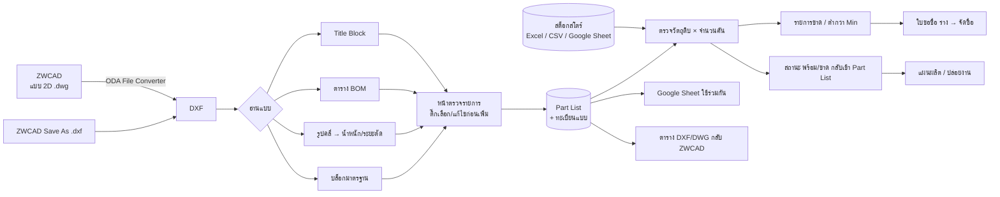

# วิเคราะห์ระบบ: นำแบบ 2D (DWG) จาก ZWCAD เข้าโปรแกรม ให้สอดคล้องกับสโตร์ คลังสินค้า และฝ่ายผลิต

## 1. เป้าหมาย

ให้ **แบบ 2D ที่ฝ่ายเขียนแบบทำใน ZWCAD (ZW2D)** เป็นต้นทางข้อมูลชุดเดียวของ Part List
โดยที่สโตร์ จัดซื้อ และฝ่ายผลิตใช้ข้อมูลชุดเดียวกัน ไม่ต้องพิมพ์ซ้ำ:

* ฝ่ายผลิต (วางแผน) ได้ **Part List** ที่มีชิ้นส่วน วัสดุ ขนาด/ความหนา จำนวน น้ำหนัก กระบวนการ
* สโตร์/จัดซื้อ ได้ **ยอดวัตถุดิบและ Parts ที่ต้องใช้ × จำนวนคัน** เทียบกับคงเหลือ → รายการขาด / ใบขอซื้อ (ร่าง)
* ทุกฝ่ายเห็นข้อมูลเดียวกันผ่าน **Google Sheet** และไฟล์ Excel

## 2. ข้อจำกัดของไฟล์ DWG และแนวทางที่เลือก

| ประเด็น | ข้อเท็จจริง | แนวทางในโปรแกรม |
|---|---|---|
| รูปแบบไฟล์ | DWG เป็นไฟล์ไบนารีปิดของ Autodesk ไม่มีไลบรารีฟรีที่อ่านตรงได้ครบทุกเวอร์ชัน | แปลง **DWG → DXF** ก่อน แล้วอ่าน DXF ด้วย `ezdxf` |
| ตัวแปลง | **ODA File Converter** ฟรี มี Windows / macOS / Linux, รองรับ DWG R12–2018+ | ค้นหาอัตโนมัติในตำแหน่งติดตั้งมาตรฐาน หรือระบุเองในหน้า *ตั้งค่า* (รองรับ LibreDWG `dwg2dxf` ด้วย) |
| ไม่มีตัวแปลง | – | ใน ZWCAD ใช้ `Save As → DXF` แล้วนำเข้า DXF ได้ทันที |
| ส่งกลับ ZWCAD | ZWCAD เปิด DXF ได้โดยตรง | ส่งออกตาราง Part List เป็น **DXF** (และ **DWG** ถ้ามี ODA) ให้ `INSERT` วางลงในแบบได้ |

ไฟล์ต้นฉบับ DWG **ไม่ถูกแก้ไข** – โปรแกรมแปลงลงโฟลเดอร์ชั่วคราวแล้วอ่านอย่างเดียว

## 3. ข้อมูลในแบบ → ช่องข้อมูลในระบบ

| สิ่งที่อยู่ในแบบ ZWCAD | วิธีอ่าน | ไปที่ช่อง | ใช้กับ |
|---|---|---|---|
| Title Block (บล็อกที่มี Attribute `DWG_NO`, `TITLE`, `MATERIAL`, `THK`, `QTY`, `REV`) | อ่าน ATTRIB ของ INSERT ทั้ง Model และ Layout | เลขที่แบบ, ชื่อชิ้นส่วน, วัสดุ, ความหนา, จำนวน, Rev. + ข้อมูลงาน | ทะเบียนแบบ, Part List |
| ข้อความ `MATERIAL : SS400`, `THK 3.2` | อ่าน TEXT/MTEXT รูปแบบ `ชื่อ : ค่า` | เหมือนด้านบน (กรณีไม่ได้ใช้ Attribute) | |
| ตาราง BOM แบบ **ACAD_TABLE** | อ่านเซลล์ตาราง | แถวใน Part List | Part List |
| ตาราง BOM ที่วาดด้วย **เส้น + ข้อความ** | จัดกลุ่มข้อความเป็นแถว/คอลัมน์ หาแถวหัวตาราง (ลำดับ, รหัส, ชื่อ, วัสดุ, จำนวน …) รองรับหัวตารางอยู่ล่าง (BOM เหนือ Title Block) | แถวใน Part List | Part List |
| รูปคลี่ชิ้นงาน (เส้นปิด LWPOLYLINE / CIRCLE หรือ LINE+ARC ต่อกันเป็นวง) | หาวงปิด → แยกเส้นรอบนอก / รู / กรอบแบบ | พื้นที่สุทธิ, ระยะตัด, ขนาดกว้าง×ยาว, **น้ำหนัก/ชิ้น** | สโตร์ (กก. เหล็กแผ่น), ฝ่ายผลิต (เวลาตัดเลเซอร์/พับ) |
| บล็อกชิ้นส่วนมาตรฐาน (น็อต บานพับ) | นับจำนวน INSERT แต่ละชื่อบล็อก | รายการ “ซื้อสำเร็จ” (เลือกเพิ่มได้) | สโตร์/จัดซื้อ |
| ข้อความภายในรูปคลี่ (เช่น `P1`) | ข้อความที่อยู่ในเส้นรอบนอก | ชื่อชิ้น (กรณีหลายชิ้นในแบบเดียว) | Part List |

สูตรน้ำหนัก: `น้ำหนัก (kg) = พื้นที่สุทธิ (mm²) × ความหนา (mm) × ความหนาแน่น (kg/dm³) × 10⁻⁶`
ความหนาแน่นตั้งได้ในหน้า *ตั้งค่า* (SS400/SPHC/SPCC 7.85, SUS 7.93, AL 2.70 …)

## 4. ลำดับการไหลของข้อมูล

## 5. ผู้รับผิดชอบแต่ละขั้น (ตามโครงสร้างงาน RRS)

| ขั้นตอน | เจ้าของงานหลัก | เอกสารเข้า | เอกสารออก | จุดตรวจ |
|---|---|---|---|---|
| ส่งแบบที่อนุมัติแล้ว | ฝ่ายเขียนแบบ / ฝ่ายขาย (ยืนยันสเปกตาม SO) | SO, สเปกลูกค้า | DWG ที่ Rev. ล่าสุด | Rev. ตรงกับ SO |
| นำเข้าแบบ + จัดทำ Part List | ฝ่ายผลิต – วางแผนการผลิต | DWG/DXF | Part List (สถานะ *รอตรวจ*) | วัสดุ ความหนา จำนวน ครบทุกแถว (แถวแดง/เหลือง = ต้องแก้) |
| ผูกรหัสสโตร์ + ตรวจวัตถุดิบ | ฝ่ายผลิต – จัดซื้อและสต็อก / สโตร์ | Part List + สต็อกล่าสุด | ผลตรวจวัตถุดิบ, ใบขอซื้อ (ร่าง) | ใช้รายงานสต็อก **ล่าสุด** เท่านั้น, รายการ *ไม่พบในสต็อก* ให้สโตร์ยืนยัน |
| สั่งซื้อ | จัดซื้อ | ใบขอซื้อ (ร่าง) | PO | ตรวจรับเทียบ PO ก่อนอัปเดตสต็อก |
| ปล่อยงานผลิต | ฝ่ายผลิต – วางแผนการผลิต | Part List สถานะ *พร้อม* | แผนผลิต (ตัด/พับ → เชื่อม → ยิงทราย/ทำสี → พ่นสี → ประกอบ) | ไม่มีรายการ *ขาด* ก่อนปล่อยงาน |

> โปรแกรมไม่สร้างหรือสมมติตัวเลขสต็อกเอง – ยอดคงเหลือมาจากไฟล์ของสโตร์เท่านั้น
> ใบขอซื้อที่ส่งออกเป็น **ร่าง** ต้องให้จัดซื้อตรวจและออก PO ตามขั้นตอนปกติ

## 6. มาตรฐานการเขียนแบบที่ทำให้อ่านได้แม่นยำ (แนะนำให้ฝ่ายเขียนแบบใช้)

1. **หน่วยแบบเป็นมิลลิเมตร** (`INSUNITS = 4`)
2. **Title Block เป็นบล็อกมี Attribute** อย่างน้อย `DWG_NO`, `TITLE`, `MATERIAL`, `THK`, `QTY`, `REV`
   (ชื่อ Tag ภาษาไทยก็ได้ เช่น `เลขที่แบบ`, `วัสดุ`, `ความหนา`)
3. **รูปคลี่ชิ้นงานอยู่บนเลเยอร์เดียว** เช่น `CUT` และเป็นเส้นปิด – ตั้งชื่อเลเยอร์นี้ในหน้า *ตั้งค่า* เพื่อความแม่นยำสูงสุด
   (เส้นบอกขนาด เส้น Center ข้อความ กรอบแบบ อยู่เลเยอร์อื่น)
4. **ตาราง BOM** ใช้หัวคอลัมน์มาตรฐาน: `ลำดับ | รหัสชิ้นส่วน | ชื่อชิ้นส่วน | วัสดุ | ขนาด/ความหนา | จำนวน | หน่วย`
   (เพิ่ม `รหัสสโตร์` ได้ ถ้าต้องการผูกกับสต็อกตั้งแต่ในแบบ)
5. **ชื่อวัสดุให้ตรงกับไฟล์สต็อก** (เช่น `SS400`, `SUS304`, `STKR400`) และเขียนความหนาแบบ `t3.2` – ระบบใช้ *วัสดุ + ความหนา/ขนาด* จับคู่กับรายการสต็อกเมื่อยังไม่ได้ใส่รหัสสโตร์
6. ชิ้นส่วนซื้อสำเร็จเป็น **บล็อกที่ตั้งชื่อสื่อความหมาย** เช่น `BOLT_M10x30`

## 7. ไฟล์สต็อกของสโตร์

หัวตารางที่ระบบรู้จัก: `รหัสสินค้า, ชื่อสินค้า, วัสดุ, ขนาด/ความหนา, หน่วย, คงเหลือ, Min, Max, คลัง`
(อ่านจาก Excel / CSV / Google Sheet และจับคู่ชื่อหัวตารางที่ใกล้เคียงให้อัตโนมัติ)

* รายการที่หน่วยเป็น **กก.** → คิดจาก *น้ำหนัก/ชิ้น × จำนวน × จำนวนคัน*
* หน่วยอื่น (แผ่น, เส้น, ตัว) → คิดจาก *จำนวน × จำนวนคัน*
* รูปแบบไฟล์ส่งออกจากโปรแกรม Express ยังต้อง **ยืนยันด้วยไฟล์ตัวอย่างจริงของบริษัท** – ถ้าหัวตารางต่างจากข้างต้น ให้ส่งไฟล์ตัวอย่างมาเพื่อเพิ่มการจับคู่

## 8. ข้อจำกัดปัจจุบัน และแผนพัฒนาต่อ

| ข้อจำกัด | ผลกระทบ | แผน |
|---|---|---|
| ยังไม่คิดเศษจากการวางเรียงบนแผ่น (Nesting) | ยอดเหล็กแผ่นที่ใช้จริงสูงกว่าน้ำหนักชิ้นงาน | เพิ่ม % เผื่อเศษต่อวัสดุ หรือเชื่อมผลจากโปรแกรม Nesting |
| ตาราง BOM ที่หัวตารางไม่ตรงมาตรฐาน | อาจจับคอลัมน์ผิด | หน้าตรวจรายการให้แก้ก่อนเพิ่ม / ใช้หัวตารางมาตรฐานข้อ 6 |
| ยังไม่เปรียบเทียบ Rev. ของแบบ | แบบแก้ไขต้องนำเข้าใหม่เอง | เพิ่มการเทียบ Part List ระหว่าง Rev. (เพิ่ม/ลด/เปลี่ยน) |
| รูปคลี่ที่วาดเป็นบล็อก | ไม่นับเป็นชิ้นงานตัด (เพื่อไม่นับน็อต/สัญลักษณ์) | ตั้งชื่อเลเยอร์เส้นตัดในหน้า *ตั้งค่า* จะอ่านรวมในบล็อกด้วย |
| DWG ต้องมีตัวแปลง | ต้องติดตั้ง ODA File Converter ทุกเครื่อง | หรือใช้ DXF จาก ZWCAD โดยตรง |
