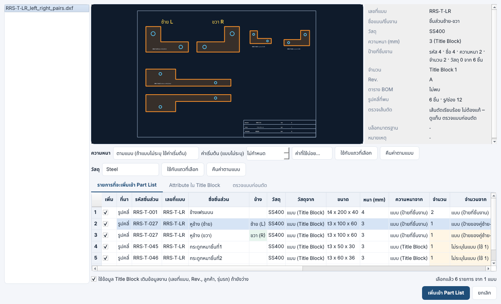
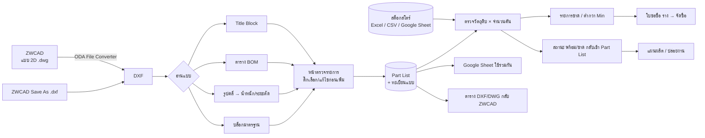

# วิเคราะห์ระบบ: นำแบบ 2D (DWG) จาก ZWCAD เข้าโปรแกรม ให้สอดคล้องกับสโตร์ คลังสินค้า และฝ่ายผลิต

## 1. เป้าหมาย

ให้ **แบบ 2D ที่ฝ่ายเขียนแบบทำใน ZWCAD (ZW2D)** เป็นต้นทางข้อมูลชุดเดียวของ Part List
โดยที่สโตร์ จัดซื้อ และฝ่ายผลิตใช้ข้อมูลชุดเดียวกัน ไม่ต้องพิมพ์ซ้ำ:

* ฝ่ายผลิต (วางแผน) ได้ **Part List** ที่มีชิ้นส่วน วัสดุ ขนาด/ความหนา จำนวน น้ำหนัก กระบวนการ
* สโตร์/จัดซื้อ ได้ **ยอดวัตถุดิบและ Parts ที่ต้องใช้ × จำนวนคัน** เทียบกับคงเหลือ → รายการขาด / ใบขอซื้อ (ร่าง)
* ทุกฝ่ายเห็นข้อมูลเดียวกันผ่าน **Google Sheet** และไฟล์ Excel

## 2. ข้อจำกัดของไฟล์ DWG และแนวทางที่เลือก

| ประเด็น | ข้อเท็จจริง | แนวทางในโปรแกรม |
|---|---|---|
| รูปแบบไฟล์ | DWG เป็นไฟล์ไบนารีปิดของ Autodesk ไม่มีไลบรารีฟรีที่อ่านตรงได้ครบทุกเวอร์ชัน | แปลง **DWG → DXF** ก่อน แล้วอ่าน DXF ด้วย `ezdxf` |
| ตัวแปลง | **ODA File Converter** ฟรี มี Windows / macOS / Linux, รองรับ DWG R12–2018+ | ค้นหาอัตโนมัติในตำแหน่งติดตั้งมาตรฐาน หรือระบุเองในหน้า *ตั้งค่า* (รองรับ LibreDWG `dwg2dxf` ด้วย) |
| ไม่มีตัวแปลง | – | ใน ZWCAD ใช้ `Save As → DXF` แล้วนำเข้า DXF ได้ทันที |
| ส่งกลับ ZWCAD | ZWCAD เปิด DXF ได้โดยตรง | ส่งออกตาราง Part List เป็น **DXF** (และ **DWG** ถ้ามี ODA) ให้ `INSERT` วางลงในแบบได้ |

ไฟล์ต้นฉบับ DWG **ไม่ถูกแก้ไข** – โปรแกรมแปลงลงโฟลเดอร์ชั่วคราวแล้วอ่านอย่างเดียว

## 3. ข้อมูลในแบบ → ช่องข้อมูลในระบบ

| สิ่งที่อยู่ในแบบ ZWCAD | วิธีอ่าน | ไปที่ช่อง | ใช้กับ |
|---|---|---|---|
| Title Block (บล็อกที่มี Attribute `DWG_NO`, `TITLE`, `MATERIAL`, `THK`, `QTY`, `REV`) | อ่าน ATTRIB ของ INSERT ทั้ง Model และ Layout | เลขที่แบบ, ชื่อชิ้นส่วน, วัสดุ, ความหนา, จำนวน, Rev. + ข้อมูลงาน | ทะเบียนแบบ, Part List |
| ข้อความ `MATERIAL : SS400`, `THK 3.2` | อ่าน TEXT/MTEXT รูปแบบ `ชื่อ : ค่า` | เหมือนด้านบน (กรณีไม่ได้ใช้ Attribute) | |
| ตาราง BOM แบบ **ACAD_TABLE** | อ่านเซลล์ตาราง | แถวใน Part List | Part List |
| ตาราง BOM ที่วาดด้วย **เส้น + ข้อความ** | จัดกลุ่มข้อความเป็นแถว/คอลัมน์ หาแถวหัวตาราง (ลำดับ, รหัส, ชื่อ, วัสดุ, จำนวน …) รองรับหัวตารางอยู่ล่าง (BOM เหนือ Title Block) | แถวใน Part List | Part List |
| รูปคลี่ชิ้นงาน (เส้นปิด LWPOLYLINE / CIRCLE หรือ LINE+ARC ต่อกันเป็นวง) | หาวงปิด → แยกเส้นรอบนอก / รู / กรอบแบบ | พื้นที่สุทธิ, ระยะตัด, ขนาดกว้าง×ยาว, **น้ำหนัก/ชิ้น** | สโตร์ (กก. เหล็กแผ่น), ฝ่ายผลิต (เวลาตัดเลเซอร์/พับ) |
| บล็อกชิ้นส่วนมาตรฐาน (น็อต บานพับ) | นับจำนวน INSERT แต่ละชื่อบล็อก | รายการ “ซื้อสำเร็จ” (เลือกเพิ่มได้) | สโตร์/จัดซื้อ |
| **ป้ายของรูปคลี่แต่ละชิ้น** – ข้อความในรูปคลี่ หรือห่างจากรูปคลี่ไม่เกิน 5 เท่าความสูงตัวอักษร | ดูข้อ 3.1 | **รหัสชิ้นส่วน, ชื่อชิ้นส่วน, ความหนา**, วัสดุ, จำนวน ของชิ้นนั้น | Part List, แผนตัด, น้ำหนัก |

### 3.1 รหัส ชื่อ ความหนา จำนวน และวัสดุรายชิ้น (แบบเดียวมีหลายชิ้น)

เขียนป้ายไว้ในรูปคลี่ หรือติดกับรูปคลี่ (ใต้/เหนือ/ข้าง) แบบใดแบบหนึ่ง:

| วิธีเขียนในแบบ | ตัวอย่าง | อ่านได้ |
|---|---|---|
| ข้อความแยกบรรทัด | `RRS-T-001` / `เฟรมบน` / `t=3` / `16 ชิ้น` / `M=Steel` | รหัส RRS-T-001 · ชื่อ เฟรมบน · หนา 3 · จำนวน 16 · วัสดุ Steel |
| ข้อความเดียว | `RRS-T-002 เฟรมล่าง t3.2 2 ชิ้น M=Stainless` | รหัส · ชื่อ · หนา 3.2 · จำนวน 2 · วัสดุ Stainless |
| `ชื่อ : ค่า` | `PART NO: RRS-T-010`, `NAME: แผ่นพื้น`, `THK: 4.5`, `QTY: 3` | ตามชื่อช่อง |
| บล็อก Attribute ป้ายชิ้นงาน | Tag `PART_NO`, `NAME`, `THK`, `QTY` (หรือ `รหัสชิ้นส่วน`, `ชื่อชิ้นส่วน`, `ความหนา`, `จำนวน`) | ตามชื่อ Tag |
| ชื่อ + จำนวน | `ขาจับ 16 ชิ้น` | ชื่อ ขาจับ · จำนวน 16 |
| หมายเหตุจากโปรแกรมแผ่นพับ | `Thickness=2.00` | หนา 2 |

* รหัสคือคำที่เป็น **ตัวอักษร-ตัวเลขคั่นด้วยขีด** และมีตัวเลข เช่น `RRS-T-001`, `RRS-TB-001`, `STD-M10-30`
* ความหนาอ่านได้จาก `t3`, `t=3`, `T: 3`, `THK 3`, `Thickness=3.00`, `หนา 3`, `3 มิล`, `3 mm` (ไม่เกิน 50 มม.)
* จำนวนอ่านได้จาก **`16 ชิ้น`**, `16ชิ้น`, `จำนวน 16`, `QTY: 16`, `16 pcs`, `1,000 ชิ้น` (เลขไทย `๑๖ ชิ้น` ก็ได้)
* วัสดุเขียน **`M=วัสดุ` ต่อจากจำนวนชิ้น** (หรือเป็นบรรทัดถัดไปของป้าย): `M=Steel`, `M=Aluminium`, `M=Stainless`,
  `M="SUS304"`, `M = ss400`, `MAT: SPHC`, `วัสดุ=Steel` – ตัวพิมพ์เล็ก/ใหญ่ได้หมด (`steel` → `Steel`, `sus304` → `SUS304`)
  และ `M=` ไม่ถูกรวมเป็นส่วนของชื่อชิ้น
* ข้อความมุมพับ (`90.0`, `UP 90° R 0`) และหมายเหตุที่มีความหนา (`หนา 9มิล 4 ชิ้น`) ไม่ถูกใช้เป็นชื่อ
* บล็อกที่มี `DWG_NO` / `REV` / `SCALE` คือ Title Block – ค่าในนั้นใช้กับทั้งแบบ ไม่ใช่ป้ายของชิ้นใดชิ้นหนึ่ง

**ลำดับการเลือกความหนา** (คอลัมน์ *ความหนาจาก* ในหน้าต่างนำเข้า):

1. `แบบ (ป้ายที่ชิ้นงาน)` – เขียนไว้ที่รูปคลี่ชิ้นนั้น
2. `แบบ (Title Block)` – THK ของ Title Block
3. `ค่าเริ่มต้น` – ค่าที่ตั้งไว้ (หน้า *ตั้งค่า* หรือในหน้าต่างนำเข้า) สำหรับแบบที่ไม่ระบุ
4. `ไม่พบในแบบ` (แถบแดง) – ยังไม่มีความหนา คำนวณน้ำหนักไม่ได้

**ลำดับการเลือกวัสดุ** (คอลัมน์ *วัสดุจาก* ในหน้าต่างนำเข้า):

1. `แบบ (ป้ายที่ชิ้นงาน)` – `M=Steel` เขียนไว้ใน/ติดรูปคลี่ชิ้นนั้น
2. `แบบ (หมายเหตุในแบบ)` – `M=Steel` หรือ `MATERIAL : SS400` ที่ไม่ได้อยู่ติดชิ้นใด ใช้กับทุกชิ้นที่ไม่มีวัสดุของตัวเอง
   (ถ้าหมายเหตุให้วัสดุมากกว่า 1 ชนิด จะไม่เดา)
3. `แบบ (Title Block)` – MATERIAL / วัสดุ ของ Title Block
4. `ไม่พบในแบบ` (แถบส้ม) – เลือกวัสดุเอง

วัสดุกำหนด **ความหนาแน่นที่ใช้คิดน้ำหนัก** (Steel 7.85 · Stainless 7.93 · Aluminium 2.70) และ **กลุ่มความเร็วตัดเลเซอร์**
และ**เปลี่ยนภายหลังได้** – ทุกครั้งที่เปลี่ยน น้ำหนัก/ชิ้นคำนวณใหม่ และค่าที่อ่านจากแบบเก็บไว้ให้คืนค่าได้:

* **หน้าต่างนำเข้าแบบ** – ดับเบิลคลิกช่อง *วัสดุ* เลือกจากรายการ (หรือพิมพ์), แถบ *วัสดุ* ด้านบน: *ใช้กับแถวที่เลือก* / *คืนค่าตามแบบ*
* **หน้า Part List** – ช่อง *วัสดุ* (ดับเบิลคลิกเลือก, ชี้เมาส์ดูว่าอ่านจากข้อความใด) และปุ่ม **เปลี่ยนวัสดุ…**
  (แถวที่เลือก / ทุกรายการ / เฉพาะที่ยังไม่มีวัสดุ หรือคืนค่าตามแบบ DWG)
* วัสดุที่เปลี่ยนในหน้า Part List อัปเดต **คลังรูปคลี่** ของรหัสนั้นด้วย – แผนตัดเลเซอร์จัดชิ้นเข้าแผ่นวัสดุใหม่ทันที

**ลำดับการเลือกจำนวน** (คอลัมน์ *จำนวนจาก* ในหน้าต่างนำเข้า):

1. `แบบ (ป้ายที่ชิ้นงาน)` – `16 ชิ้น` เขียนไว้ใน/ติดรูปคลี่ชิ้นนั้น · ถ้าเขียน **`อย่างละ 2 ชิ้น`** ไว้ระหว่างหลายชิ้น
   ทุกชิ้นที่อยู่ติดข้อความนั้นได้ 2 (ความหนาในข้อความเดียวกัน เช่น `หนา 9มิล อย่างละ1 ชิ้น` ก็ใช้กับทุกชิ้นนั้น)
2. `แบบ (หมายเหตุในแบบ)` – หมายเหตุที่ไม่ได้อยู่ติดชิ้นใด: `อย่างละ 2 ชิ้น` ใช้กับทุกชิ้นที่ยังไม่มีจำนวนของตัวเอง,
   `16 ชิ้น` ใช้เมื่อแบบนั้นมีชิ้นเดียว (แบบหลายชิ้นจะแสดงหมายเหตุนั้นในช่อง *จำนวน* ด้านขวา แต่ไม่เดาให้)
3. `แบบ (Title Block)` – QTY ของ Title Block (แบบที่มีชิ้นเดียว)
4. `ไม่ระบุในแบบ (ใช้ 1)` (แถบส้ม) – ให้ตรวจ/พิมพ์จำนวนเอง

จำนวนที่อ่านได้ **บันทึกไว้กับรายการใน Part List** (ชี้เมาส์ที่ช่อง *จำนวน* จะเห็นว่าอ่านจากข้อความใด และค่าในแบบถ้าแก้ภายหลัง)
และหน้า *แบบ 2D* แสดง **จำนวนชิ้นรวม** ของแต่ละแบบ

**ซ้าย (L) / ขวา (R) จากตำแหน่งที่วาง** (คอลัมน์ *ข้าง* ในหน้าต่างนำเข้า):

* ชิ้นเดียวกันวาด 2 รูป **วางคู่กันในแนวนอน** (อยู่แถวเดียวกัน ติดกัน) → ชิ้นที่วาง**ฝั่งซ้าย = ซ้าย (L)**
  ชิ้นที่วาง**ฝั่งขวา = ขวา (R)** และชื่อได้ข้างต่อท้าย `หูช้าง (ซ้าย)` / `หูช้าง (ขวา)` (แถบเขียว = อ่านจากตำแหน่งในแบบ)
* *ชิ้นเดียวกัน* คือ รหัสเดียวกันทั้งสองรูป หรือรูปที่ไม่มีป้าย เป็นรูปเดียวกัน / รูปกลับด้าน (Mirror) ของชิ้นที่วางติดกัน
  (ต้องมีรู หรือไม่ใช่แผ่นสี่เหลี่ยมเรียบ) – รูปที่ไม่มีป้ายได้ **รหัส ชื่อ ความหนา วัสดุ** ของคู่
* จำนวนที่เขียนไว้ชิ้นเดียว: **เลขคู่ = รวมทั้งคู่** (`2 ชิ้น` → ซ้าย 1 + ขวา 1) เลขคี่ = ข้างละเท่านั้น –
  *จำนวนจาก* แสดง `แบบ (ป้ายของคู่ซ้าย-ขวา)` (แถบส้ม ให้ตรวจ)
* ชื่อหรือรหัสบอกข้างไว้แล้ว (`หูล็อคฝาท้าย ซ้าย`, `RRS-A-027-L`) → ใช้ตามนั้น อีกชิ้นได้ข้างตรงข้าม
* วางซ้อนบน-ล่าง (แนวตั้ง) หรือ 3 รูปเรียงกัน → ไม่อ่านข้าง (เหมือนเดิม)
* เปลี่ยนเองได้: ดับเบิลคลิกช่อง *ข้าง* เลือก ซ้าย (L) / ขวา (R) / ว่าง – ชื่อเปลี่ยนตาม · ภาพตัวอย่างแสดง `ซ้าย L` / `ขวา R`
  บนชิ้น · ข้างที่อ่านได้ใช้ต่อใน **การจับคู่รหัสอัตโนมัติ** (ข้อ 7.1)

ปรับความหนาได้ 3 ที่ – ทุกครั้งที่เปลี่ยน **ขนาด (t3 x 150 x 60) และน้ำหนัก/ชิ้นคำนวณใหม่** จากพื้นที่รูปคลี่:

* **หน้าต่างนำเข้าแบบ** – เลือก *ตามแบบ* หรือ *กำหนดเองทุกชิ้น* + ค่าความหนา, พิมพ์ในช่อง *หนา (mm)* ทีละแถว,
  ปุ่ม *ใช้กับแถวที่เลือก* และ *คืนค่าตามแบบ*
* **หน้า Part List** – ช่อง *หนา (mm)* (มีค่าที่ใช้บ่อยให้เลือก) และปุ่ม *ปรับความหนา…*
  (แถวที่เลือก / ทุกชิ้นที่เป็นแผ่น / เฉพาะชิ้นที่ยังไม่มีความหนา หรือคืนค่าตามแบบ DWG ที่อ่านไว้ตอนนำเข้า)
* **หน้า ตั้งค่า** – การกำหนดความหนาและความหนาเริ่มต้นที่ใช้ทุกครั้งที่นำเข้า

**ตรวจและแก้เส้นตัดก่อนตัด** – ตอนนำเข้า เส้นตัดที่ไม่ปิดวงถูกแก้อัตโนมัติ: ต่อมุมที่ห่างไม่เกิน 0.5 มม., ตัดเส้นยื่นเกินมุม,
ลบเส้นซ้ำ/วงซ้อน, แยกเส้นพับ (ไม่ตัด เก็บไว้มาร์ค), ลบเส้นช่วยและตัวเลข/ตัวอักษรที่เป็นเส้นในชิ้นงาน (เช่น `90`)
ทุกจุดแสดงในแท็บ *ตรวจแบบก่อนตัด* ของหน้าต่างนำเข้า และติดไปกับรายการใน Part List / คลังรูปคลี่ –
รายละเอียดและเกณฑ์: [PRE_CUT_CHECK.md](PRE_CUT_CHECK.md)

สูตรน้ำหนัก: `น้ำหนัก (kg) = พื้นที่สุทธิ (mm²) × ความหนา (mm) × ความหนาแน่น (kg/dm³) × 10⁻⁶`
ความหนาแน่นตั้งได้ในหน้า *ตั้งค่า* (SS400/SPHC/SPCC 7.85, SUS 7.93, AL 2.70 …)

## 4. ลำดับการไหลของข้อมูล

## 5. ผู้รับผิดชอบแต่ละขั้น (ตามโครงสร้างงาน RRS)

| ขั้นตอน | เจ้าของงานหลัก | เอกสารเข้า | เอกสารออก | จุดตรวจ |
|---|---|---|---|---|
| ส่งแบบที่อนุมัติแล้ว | ฝ่ายเขียนแบบ / ฝ่ายขาย (ยืนยันสเปกตาม SO) | SO, สเปกลูกค้า | DWG ที่ Rev. ล่าสุด | Rev. ตรงกับ SO |
| นำเข้าแบบ + จัดทำ Part List | ฝ่ายผลิต – วางแผนการผลิต | DWG/DXF | Part List (สถานะ *รอตรวจ*) | วัสดุ ความหนา จำนวน ครบทุกแถว (แถวแดง/เหลือง = ต้องแก้) |
| ผูกรหัสสโตร์ + ตรวจวัตถุดิบ | ฝ่ายผลิต – จัดซื้อและสต็อก / สโตร์ | Part List + สต็อกล่าสุด | ผลตรวจวัตถุดิบ, ใบขอซื้อ (ร่าง) | ใช้รายงานสต็อก **ล่าสุด** เท่านั้น, รายการ *ไม่พบในสต็อก* ให้สโตร์ยืนยัน |
| สั่งซื้อ | จัดซื้อ | ใบขอซื้อ (ร่าง) | PO | ตรวจรับเทียบ PO ก่อนอัปเดตสต็อก |
| ปล่อยงานผลิต | ฝ่ายผลิต – วางแผนการผลิต | Part List สถานะ *พร้อม* | แผนผลิต (ตัด/พับ → เชื่อม → ยิงทราย/ทำสี → พ่นสี → ประกอบ) | ไม่มีรายการ *ขาด* ก่อนปล่อยงาน |

> โปรแกรมไม่สร้างหรือสมมติตัวเลขสต็อกเอง – ยอดคงเหลือมาจากไฟล์ของสโตร์เท่านั้น
> ใบขอซื้อที่ส่งออกเป็น **ร่าง** ต้องให้จัดซื้อตรวจและออก PO ตามขั้นตอนปกติ

## 6. มาตรฐานการเขียนแบบที่ทำให้อ่านได้แม่นยำ (แนะนำให้ฝ่ายเขียนแบบใช้)

1. **หน่วยแบบเป็นมิลลิเมตร** (`INSUNITS = 4`)
2. **Title Block เป็นบล็อกมี Attribute** อย่างน้อย `DWG_NO`, `TITLE`, `MATERIAL`, `THK`, `QTY`, `REV`
   (ชื่อ Tag ภาษาไทยก็ได้ เช่น `เลขที่แบบ`, `วัสดุ`, `ความหนา`)
3. **รูปคลี่ชิ้นงานอยู่บนเลเยอร์เดียว** เช่น `CUT` และเป็นเส้นปิด – ตั้งชื่อเลเยอร์นี้ในหน้า *ตั้งค่า* เพื่อความแม่นยำสูงสุด
   (เส้นบอกขนาด เส้น Center ข้อความ กรอบแบบ อยู่เลเยอร์อื่น)
   **แบบที่มีหลายชิ้น ให้เขียนป้ายทุกชิ้น** `รหัส / ชื่อ / t ความหนา / จำนวน ชิ้น / M=วัสดุ` ไว้ในหรือชิดรูปคลี่ (ข้อ 3.1) – ป้ายที่อยู่กึ่งกลางระหว่าง 2 ชิ้น
   โปรแกรมให้กับชิ้นที่ใกล้กว่า
   **ชิ้นซ้าย/ขวา วางคู่กันในแนวนอน** – ชิ้นซ้ายไว้ทางซ้าย ชิ้นขวาไว้ทางขวา ในแถวเดียวกัน (หรือเขียน `ซ้าย` / `ขวา` ในป้าย)
4. **ตาราง BOM** ใช้หัวคอลัมน์มาตรฐาน: `ลำดับ | รหัสชิ้นส่วน | ชื่อชิ้นส่วน | วัสดุ | ขนาด | หนา | จำนวน | หน่วย`
   (คอลัมน์ `THK` / `ความหนา` อ่านเป็นความหนา, ถ้าไม่มีจะอ่านจาก `t3.2` ในช่องขนาด)
   (เพิ่ม `รหัสสโตร์` ได้ ถ้าต้องการผูกกับสต็อกตั้งแต่ในแบบ)
5. **ชื่อวัสดุให้ตรงกับไฟล์สต็อก** (เช่น `SS400`, `SUS304`, `STKR400`) และเขียนความหนาแบบ `t3.2` – ระบบใช้ *วัสดุ + ความหนา/ขนาด* จับคู่กับรายการสต็อกเมื่อยังไม่ได้ใส่รหัสสโตร์
6. ชิ้นส่วนซื้อสำเร็จเป็น **บล็อกที่ตั้งชื่อสื่อความหมาย** เช่น `BOLT_M10x30`

## 7. ไฟล์สต็อกของสโตร์

หัวตารางที่ระบบรู้จัก: `รหัสสินค้า, ชื่อสินค้า, วัสดุ, ขนาด/ความหนา, หน่วย, คงเหลือ, Min, Max, คลัง`
(อ่านจาก Excel / CSV / Google Sheet และจับคู่ชื่อหัวตารางที่ใกล้เคียงให้อัตโนมัติ)

* รายการที่หน่วยเป็น **กก.** → คิดจาก *น้ำหนัก/ชิ้น × จำนวน × จำนวนคัน*
* หน่วยอื่น (แผ่น, เส้น, ตัว) → คิดจาก *จำนวน × จำนวนคัน*
* รูปแบบไฟล์ส่งออกจากโปรแกรม Express ยังต้อง **ยืนยันด้วยไฟล์ตัวอย่างจริงของบริษัท** – ถ้าหัวตารางต่างจากข้างต้น ให้ส่งไฟล์ตัวอย่างมาเพื่อเพิ่มการจับคู่
* ไฟล์ Excel หลายแผ่นงาน (เช่น มีแผ่น *คำแนะนำ* ก่อน) อ่านแผ่นที่มีตารางสต็อก · แถว *รวม* ท้ายตารางไม่นับเป็นรายการ ·
  คอลัมน์ **นับได้จริง** ที่กรอกแล้วใช้แทนยอดคงเหลือ
* นำเข้าไฟล์สต็อก (หรือนำเข้าแบบเมื่อมีสต็อกอยู่แล้ว) → **ตรวจวัตถุดิบเทียบสต็อกให้ทันที**

### 7.1 จับคู่รหัสชิ้นส่วนในแบบกับรหัสสินค้าในสต็อก (เมื่อรหัสยังไม่ตรงกัน)

รหัสในแบบเป็น **รหัสหลัก** แต่แบบมักเรียงรหัสตามลำดับในแบบ (`RRS-T-001`, `RRS-T-002` …) ขณะที่ Express มีรหัสแยกตามรุ่น
ความสูงคอก ความยาวกระบะ และซ้าย/ขวา – ตัวอย่างจากแบบ `toyota-4.dwg` เทียบไฟล์นับสต็อก (รหัส Express):

**อ่านรหัสทีละหลัก** `RRS-A-039-NO1-PR` = `RRS` · **ยี่ห้อรถ** `A` · **เลขชิ้นส่วน** `039` · รุ่นย่อย/ขนาด `NO1-PR`

| หลักที่ 2 | ยี่ห้อ |
|---|---|
| `A` (`A1`) | **ALL – ใช้ได้กับทุกยี่ห้อ** |
| `T` | Toyota |
| `I` | Isuzu |
| `M` (`M1`) | Mitsubishi |
| `F` | Ford |
| `N` | Nissan |
| `S` | Suzuki |

เลขชิ้นส่วน (หลักที่ 3) บอกว่าเป็นชิ้นไหนตามแบบ เช่น `039` = เต้าที่ 1, `040` = เต้าที่ 2, `041` = เต้าที่ 3 –
ชิ้น `RRS-T-039` ในแบบ Toyota จึงเป็นรายการเดียวกับ `RRS-A-039-NO1-PR` ในสต็อก (A ใช้กับ T ได้)
ยี่ห้อรถของงานใช้ค่าที่เลือกที่หน้า **ภาพรวม → ยี่ห้อรถ (รหัสหลักที่ 2)** ถ้าไม่เลือก (อัตโนมัติ) อ่านจากตัวอักษรในรหัสของแบบ
แล้วจากชื่อในแบบ (TOYOTA, ISUZU, FORD …) · รายการของยี่ห้ออื่น (เช่น `RRS-I-…` ในงาน Toyota) ไม่ถูกเลือก

| ในแบบ | ในสต็อก | จับคู่ด้วย |
|---|---|---|
| `RRS-T-002` หน้าเฟรมบน | `RRS-T-002` หน้าเฟรมบน T | รหัสตรง |
| `RRS-T-039` เต้า1 | `RRS-A-039-NO1-PR` เต้าพื้นเรียบเบอร์ 1 | **รหัสชิ้นส่วนเดียวกัน** – 039 ตรงกัน · A = ทุกยี่ห้อ ใช้กับ T |
| `RRS-T-003` ราง 4 คู่หน้าเฟรมบน | `RRS-A-003` ราง 4 คู่หน้าเฟรม(ใช้กับทุกรุ่น) | รหัสชิ้นส่วนเดียวกัน (003) |
| `RRS-T-009` กระดูกข้างเฟรมบน | `RRS-T-009-L` + `RRS-T-009-R-` กระดูกข้าง T | รหัสชิ้นส่วนเดียวกัน · ของยี่ห้อ T ก่อนของ A |
| `RRS-T-001` ข้างเฟรมบน | `RRS-A-001-250` ข้างเฟรมบน 250 | 001 + ความยาวกระบะจาก `พื้น250` ในแบบเดียวกัน |
| `RRS-T-021` เหล็กฉากฝาข้าง | `RRS-A-021-80` เหล็กฉากฝาข้าง 80 | 021 + ความสูงคอกจาก `เสา80` `บังอาย80` ในแบบ |
| `RRS-T-027` หูช้าง | `RRS-A-027-L` + `RRS-A-027-R` | 027 · แบบไม่ระบุข้าง → แบ่งจำนวนซ้าย/ขวาอย่างละครึ่ง |
| `RRS-T-025` หูบนตัวนอก | `RRS-A-026-L` + `RRS-A-026-R` หูบนตัวนอก | ชื่อ – Express ใช้ 025 กับ *หูบนตัวใน* จึงไม่เอาตามเลข |
| `RRS-T-034` หูล็อคฝาท้าย | `RRS-A-068-L` + `RRS-A-069-R` | ชื่อ (Express ใช้เลขต่างกันสองข้าง) |
| `RRS-T-037` ชิ้นที่ 5 | `RRS-A-037-PR` บังโคลนพื้นเรียบ | เลข 037 ตรงแต่ชื่อต่างกัน → **รหัสเดียวกัน (ใกล้เคียง)** จับคู่ให้ |
| บังโครน (ไม่มีรหัส) | `RRS-A-037-PR` บังโคลนพื้นเรียบ | **ชื่อใกล้เคียง** – สะกดต่างกัน (โครน = โคลน) |
| `RRS-T-042` เต้า4 | – | **ไม่พบ** (ไม่มี 042 ในไฟล์สต็อก – ไม่เดาเป็นเบอร์อื่น) |
| `RRS-T-045` กระดูกหมาชิ้นที่1 | `RRS-T-009-L` กระดูกข้าง T(ซ้าย) | **ใกล้เคียงที่สุด** (ชื่อคล้าย 74%) – ไม่พบรหัสตรง ใช้รายการแรกที่ใกล้เคียง · แบบมี 2 ชิ้นบนคู่ซ้าย/ขวาเดียวกัน → ชิ้นแรก = ซ้าย |
| `RRS-T-046` กระดูกหมาชิ้นที่2 | `RRS-T-009-R-` กระดูกข้าง T(ขวา) | เหมือนกัน · ชิ้นที่สอง = ขวา (ระบบเลือกข้างให้) |
| `RRS-T-053` ขามอเตอร์1 + ตารางเทียบรหัสมีคู่ *ขามอเตอร์* ↔ `01-0009-0001` | `01-0009-0001` | **ตารางเทียบรหัส (ใกล้เคียง)** – ชื่อในตารางใกล้เคียง |
| `RRS-T-042` เต้า4 + ตารางเทียบรหัสมีคู่ `RRS-A-042-NO4-PR` ↔ `01-0007-0042` | `01-0007-0042` (รหัสนับสต็อก) | รหัสชิ้นส่วนเดียวกัน – อ่านรหัสนับสต็อกเป็นรหัส Express จากตาราง |

ลำดับที่ระบบใช้ (เจอแล้วหยุด) – หลักคือดู **รหัส 3 หลักหน้า** (`RRS-T-039`: คำนำหน้า · ยี่ห้อ/`A` · เลขชิ้นส่วน)
ก่อน ถ้าไม่ตรงจึงดู **ชื่อ** ที่ตรงกันหรือใกล้เคียง:

1. **รหัสสโตร์ใน Part List** – ที่ยืนยันไว้แล้ว (เขียนสองรหัสได้ `RRS-A-027-L / RRS-A-027-R`)
2. **รหัสในแบบ** ตรงกับรหัสสินค้า / ตัด 16 ตัวอักษรแบบรายงาน Express / **ตารางเทียบรหัส**
3. **รหัสชิ้นส่วนเดียวกัน** – เลขชิ้นส่วนเดียวกัน ยี่ห้อเดียวกันหรือ `A` (ทุกยี่ห้อ) · มีหลายรายการ (ขนาด ความสูงคอก
   ความยาวกระบะ ซ้าย/ขวา เบอร์ NO1…) เลือกจากชื่อและขนาดในแบบ · ชื่อที่เป็นคนละชิ้น (ตัวใน/ตัวนอก, เสา/กระดูก)
   ไม่เอา · สองรายการใกล้กันมาก → เลือกรายการที่ใกล้ที่สุด *รหัสเดียวกัน (ใกล้เคียง)* พร้อมตัวเลือกอื่น
4. **ชื่อชิ้นส่วน** – ชิ้นอะไร อยู่ตรงไหน (ข้าง/หน้า/ท้าย/บน/ล่าง) เลขชิ้นส่วนในรหัส รุ่นรถ (TOYOTA/CHAMP/…)
   ความสูงคอก ความยาวกระบะ ซ้าย/ขวา – ผลชัดเจน *จับคู่จากชื่อ*

   **เลือกข้างซ้าย/ขวาให้เอง** เมื่อชิ้นในแบบไม่ระบุข้างแต่ Express แยกรหัสซ้าย/ขวา:
   * ชิ้นที่ได้ข้างจากตำแหน่งในแบบตอนนำเข้า (`หูช้าง (ซ้าย)` – ข้อ 3.1) → ใช้รหัสข้างนั้นเลย `RRS-A-027-L` / `RRS-A-027-R`
     หมายเหตุบอก *ข้างจากแบบ (วางคู่ในแนวนอน): ชิ้นที่วางฝั่งซ้าย = ซ้าย (L)*
   * ชิ้นในแบบ **2 ชิ้นที่ต่างกัน** ตรงกับคู่ซ้าย/ขวาเดียวกัน → เป็นชิ้นซ้ายกับชิ้นขวา:
     **วางคู่กันในแนวนอน** → ชิ้นที่วาง**ฝั่งซ้าย = ซ้าย** ชิ้นที่วาง**ฝั่งขวา = ขวา** (ใช้ก่อนลำดับชิ้น) ·
     วางแนวตั้งหรือไม่รู้ตำแหน่ง → ชิ้นแรก (ชิ้นที่1 / รหัสน้อยกว่า) = **ซ้าย**, ชิ้นที่สอง = **ขวา**
     เช่น `RRS-T-045` → `RRS-T-009-L`, `RRS-T-046` → `RRS-T-009-R-`
     (ชิ้นที่จับคู่ได้จากรหัสของตัวเองคงใช้ทั้งสองข้าง)
   * แบบระบุ **1 ชิ้น** → ใช้ข้างเดียว (ซ้าย) อีกข้างอยู่ในตัวเลือกอื่น
   * ไม่ระบุข้างและจำนวน (ชิ้นเดียว เช่น หูช้าง) → ใช้ทั้งซ้ายและขวา แบ่งจำนวนอย่างละครึ่ง
5. **เลขชิ้นส่วนตรงแต่ชื่อ/ขนาด/เบอร์ต่างกัน** (เช่น `RRS-T-040` เต้า3 กับ `RRS-A-040-NO2-PR`) → จับคู่ตามรหัส
   *รหัสเดียวกัน (ใกล้เคียง)* พร้อมเหตุผล (เบอร์ 2 ≠ 3)
6. **ชื่อใกล้เคียง** – ผลจากชื่อที่ยังไม่ชัด หรือชื่อเดียวกันเมื่อสะกดให้ตรงกัน (บังโครน = บังโคลน, คัตซี = คัดซี,
   ซัพ = ซับ, นํ้า = น้ำ) · ไม่เอาเบอร์อื่นของชิ้นที่มีเบอร์ (เต้า4 ไม่ใช่เต้าเบอร์ 1) และไม่เอายี่ห้ออื่น
7. **ยังไม่พบ → ใช้ผลใกล้เคียง** (สวิตช์ *ไม่พบรหัสในสต็อก → ใช้ผลใกล้เคียง…* ในแท็บจับคู่ เปิดไว้เป็นค่าเริ่มต้น):
   ก่อนคือ **ตารางเทียบรหัส (ใกล้เคียง)** – แถวในตารางเทียบรหัสที่รหัส 3 หลักหน้าตรงกับชิ้นในแบบ (A = ทุกยี่ห้อ)
   หรือชื่อใกล้เคียง (≥ 80%) และอีกรหัสของแถวมีในสต็อก · ถ้าไม่มี **ใกล้เคียงที่สุด** – รายการแรกในรายการใกล้เคียง
   ของการจับคู่จากชื่อ · ไม่ใช้รายการของยี่ห้ออื่น และไม่ใช้เบอร์อื่นของชิ้นที่มีเบอร์ (เต้า4 ≠ เต้าเบอร์ 1)
8. **วัสดุ + ความหนา** – วัตถุดิบที่ใช้ตัด (เหล็กแผ่น) เมื่อไม่พบชิ้นสำเร็จในสต็อก
9. ไม่พบ – ไม่มีรายการใกล้เคียงเลย (ต้องเปิดรหัสใหม่ใน Express หรือเพิ่มคู่ในตารางเทียบรหัส)

ตารางเทียบรหัสยังช่วยรหัสนับสต็อกแบบเก่า (`01-0001-0039`): รายการที่รหัสอ่านทีละหลักไม่ได้ ใช้รหัส Express คู่ของมัน
ในตาราง ข้อ 3 จึงจับคู่ด้วยรหัส 3 หลักหน้าได้ และหมายเหตุบอก `01-0001-0039 = RRS-A-039-NO1-PR ตามตารางเทียบรหัส`

ผล **ใกล้เคียง** (ข้อ 3 กรณีใกล้กัน, 5, 6, 7) **จับคู่ให้เลย** – ใช้ตรวจวัตถุดิบเทียบสต็อกและเขียนเป็นรหัสสโตร์เหมือนผลชัดเจน
แต่ขึ้นสีฟ้าอมเขียว อยู่บนสุดของแท็บ และหมายเหตุบอก *ตัวเลือกอื่น* ให้คนเปลี่ยนได้

หน้า **สโตร์ → ตรวจวัตถุดิบ / Parts**: คอลัมน์ *การจับคู่* ในผลตรวจ และแท็บ **จับคู่ชิ้นส่วน ↔ สต็อก** (แถวใกล้เคียงขึ้นก่อน,
คอลัมน์ *อ่านรหัส* บอกว่าจับจากหลักไหน เช่น `เลขชิ้นส่วน 039 ตรงกัน · A = ทุกยี่ห้อ ใช้กับ T (Toyota)`)
→ **ยืนยันรหัสที่เลือก → รหัสสโตร์ใน Part List** (ครั้งต่อไปใช้รหัสนี้ทันที) หรือ **ล้างรหัสสโตร์** ให้จับคู่ใหม่ ·
*อัปเดตสถานะใน Part List* เขียนรหัสสโตร์ของทุกคู่ที่จับได้ · ส่งออกผลตรวจ (Excel) มีแผ่น *จับคู่ชิ้นส่วน*

## 8. ข้อจำกัดปัจจุบัน และแผนพัฒนาต่อ

| ข้อจำกัด | ผลกระทบ | แผน |
|---|---|---|
| ยังไม่คิดเศษจากการวางเรียงบนแผ่น (Nesting) | ยอดเหล็กแผ่นที่ใช้จริงสูงกว่าน้ำหนักชิ้นงาน | เพิ่ม % เผื่อเศษต่อวัสดุ หรือเชื่อมผลจากโปรแกรม Nesting |
| ตาราง BOM ที่หัวตารางไม่ตรงมาตรฐาน | อาจจับคอลัมน์ผิด | หน้าตรวจรายการให้แก้ก่อนเพิ่ม / ใช้หัวตารางมาตรฐานข้อ 6 |
| ยังไม่เปรียบเทียบ Rev. ของแบบ | แบบแก้ไขต้องนำเข้าใหม่เอง | เพิ่มการเทียบ Part List ระหว่าง Rev. (เพิ่ม/ลด/เปลี่ยน) |
| รูปคลี่ที่วาดเป็นบล็อก | ไม่นับเป็นชิ้นงานตัด (เพื่อไม่นับน็อต/สัญลักษณ์) | ตั้งชื่อเลเยอร์เส้นตัดในหน้า *ตั้งค่า* จะอ่านรวมในบล็อกด้วย |
| DWG ต้องมีตัวแปลง | ต้องติดตั้ง ODA File Converter ทุกเครื่อง | หรือใช้ DXF จาก ZWCAD โดยตรง |
