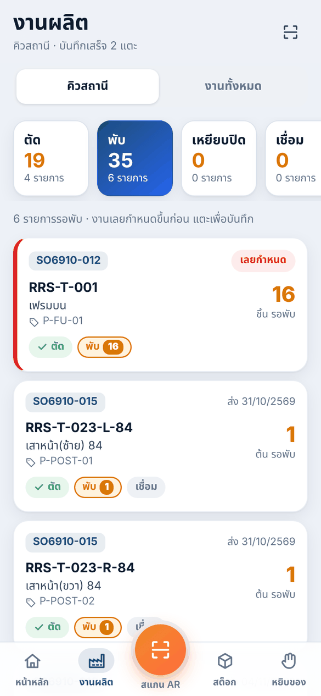
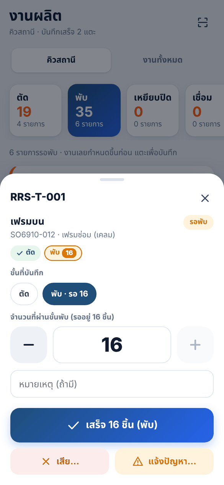
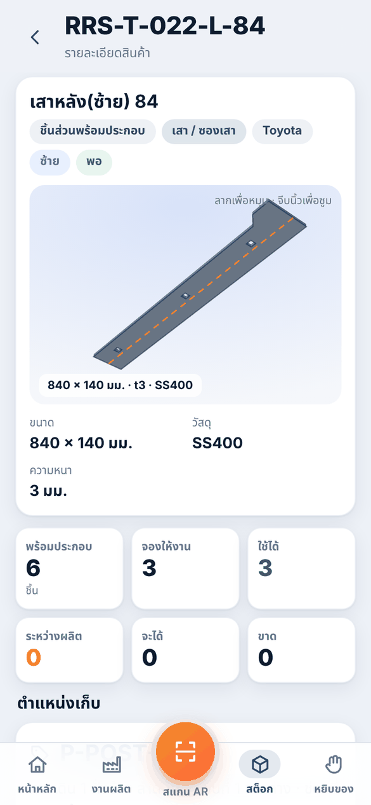
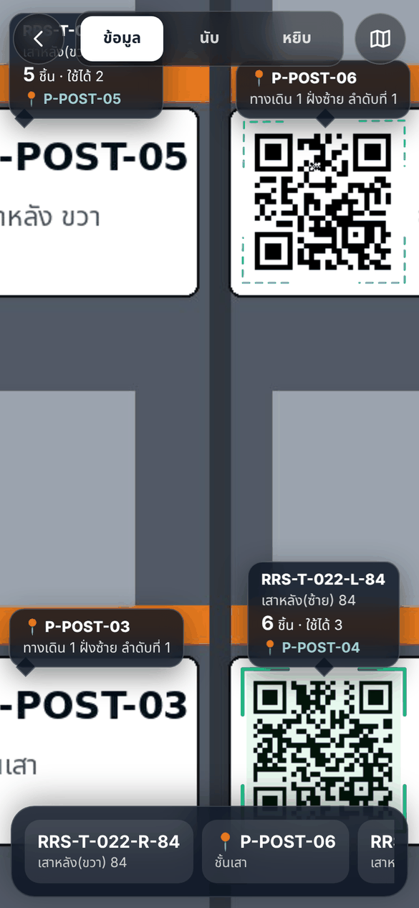
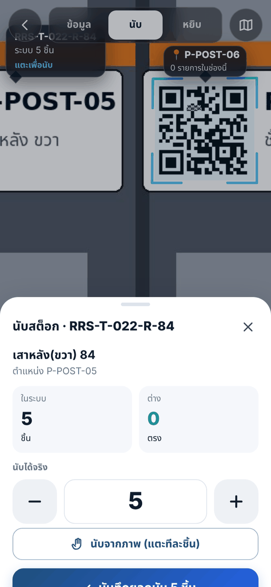
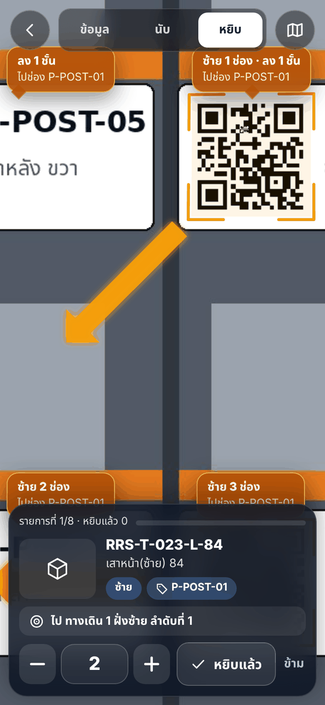
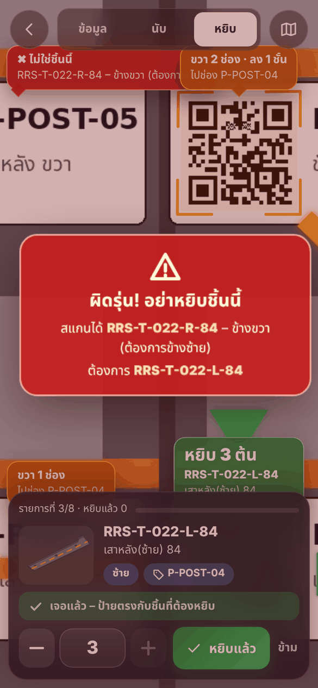
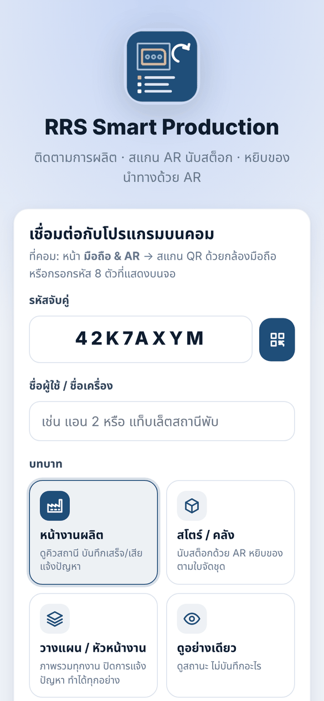
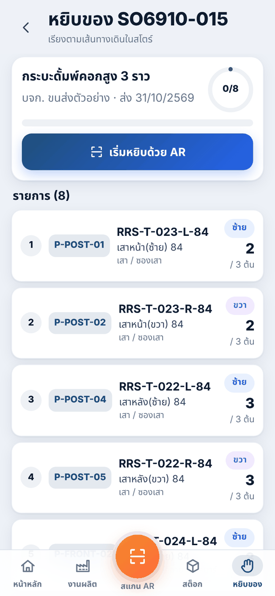
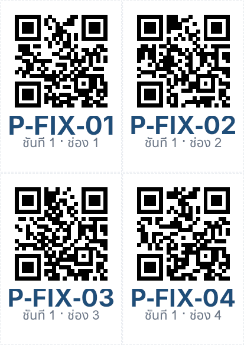

# แอปมือถือ – ติดตามการผลิต · สแกน AR นับสต็อก · หยิบของนำทางด้วย AR

แอป **RRS Smart Production** ใช้บน **Android · iPhone · iPad · แท็บเล็ต** ผ่าน Wi-Fi ในโรงงาน
ใช้ข้อมูลชุดเดียวกับ RRS Part List Studio บนคอม (งานผลิต สต็อก ตำแหน่งเก็บ รูปคลี่ เอกสาร) ไม่มีการคัดลอกข้อมูลไปไว้ในมือถือ

```
 มือถือ / แท็บเล็ต (เบราว์เซอร์ หรือไอคอนบนหน้าจอหลัก)
        │  Wi-Fi ในโรงงาน · HTTPS (ใบรับรองของคอมเครื่องนี้)
        ▼
 คอมที่เปิด RRS Part List Studio  →  หน้า "มือถือ & AR"
        │  ข้อมูลเดียวกับทุกหน้าของโปรแกรม (library.json)
        ▼
 งานผลิต (SO) · สต็อก 6 ช่อง · ตำแหน่งเก็บ · คลังรูปคลี่ · ใบเบิก/รับ (AJ, PD)
```

ทำเป็น **เว็บแอปติดตั้งได้ (PWA)** ที่โปรแกรมบนคอมเปิดให้เอง เพราะ
* ใช้ได้ทุกยี่ห้อ ทุกขนาดจอ ด้วยโค้ดชุดเดียว · ไม่ต้องผ่าน App Store / Play Store · ไม่มีค่าใช้จ่ายรายปี
* อัปเดตพร้อมโปรแกรมบนคอม (เปิดแอปใหม่ก็ได้เวอร์ชันล่าสุด) · ข้อมูลอยู่ในคอมของบริษัท ไม่ขึ้นคลาวด์
* เพิ่มไอคอนลงหน้าจอหลักแล้วเปิดเต็มจอเหมือนแอปทั่วไป

| หน้าแรก | คิวสถานี | บันทึก 2 แตะ | ชิ้นงาน 3 มิติ |
|---|---|---|---|
|  |  |  |  |

| AR ส่องป้ายดูข้อมูล | AR นับสต็อก | AR นำทางไปช่อง | เจอช่องที่ต้องหยิบ | เตือนหยิบผิดรุ่น |
|---|---|---|---|---|
|  |  |  |  |  |

## 1. เริ่มใช้งาน (ครั้งแรก)

**บนคอม**
1. เปิดโปรแกรม → เมนูซ้าย **▯ มือถือ & AR** → กด **เปิดใช้งานมือถือ**
2. Windows ถามเรื่องไฟร์วอลล์ → กด **อนุญาต** (เครือข่ายส่วนตัว) · macOS ถาม *รับการเชื่อมต่อเข้ามา* → **อนุญาต**
3. ติ๊ก **เปิดใช้งานมือถือทุกครั้งที่เปิดโปรแกรม** ถ้าจะใช้ประจำ


**บนมือถือ / แท็บเล็ต** (ต่อ Wi-Fi เดียวกับคอม)
1. เปิดกล้องมือถือ **สแกน QR บนจอคอม** → หน้า *ติดตั้งแอปมือถือ* จะเปิดขึ้น
2. **ติดตั้งใบรับรองของคอมเครื่องนี้ (ครั้งเดียวต่อเครื่อง)** – ให้แอปใช้กล้องได้และไม่ขึ้นหน้าเตือน
   * **iPhone / iPad** (ใช้ Safari): กด *ดาวน์โหลดใบรับรอง* → *อนุญาต* → **ตั้งค่า → ดาวน์โหลดโปรไฟล์แล้ว → ติดตั้ง** →
     แล้ว **ตั้งค่า → ทั่วไป → เกี่ยวกับ → การตั้งค่าความเชื่อถือใบรับรอง → เปิดสวิตช์** *RRS Part List Studio Local CA*
   * **Android**: กด *ดาวน์โหลดใบรับรอง* → **การตั้งค่า → ความปลอดภัย → การเข้ารหัสและข้อมูลเข้าสู่ระบบ → ติดตั้งใบรับรอง →
     ใบรับรอง CA** → เลือกไฟล์ `rrs-partlist-ca.crt` (แต่ละยี่ห้อชื่อเมนูต่างกันเล็กน้อย – ค้นหาคำว่า *ใบรับรอง*)
   * หน้าติดตั้งบอกให้เองว่า *✓ เครื่องนี้เชื่อถือใบรับรองแล้ว* · ตรวจลายนิ้วมือใบรับรองกับที่แสดงบนคอมได้
3. กด **เปิดแอปมือถือ** → ใส่ชื่อ (เช่น *แอน 2* หรือ *แท็บเล็ตสถานีพับ*) เลือกบทบาท (และสถานีถ้าเป็นหน้างาน) → **เริ่มใช้งาน**
4. เพิ่มลงหน้าจอหลัก: iPhone ปุ่มแชร์ → **เพิ่มไปยังหน้าจอโฮม** · Android เมนู ⋮ → **ติดตั้งแอป**
   (iPhone: แอปบนหน้าจอโฮมแยกข้อมูลจาก Safari – ถ้าขอจับคู่อีกครั้ง กดปุ่ม QR ในหน้าจับคู่แล้วสแกนจอคอม)

รหัสจับคู่ใช้ได้ 15 นาที จับคู่ได้หลายเครื่องด้วย QR เดียวกัน · เครื่องที่จับคู่แล้วใช้ต่อได้เรื่อย ๆ ไม่ต้องสแกนใหม่
ยังไม่ติดตั้งใบรับรองก็เปิดได้ (กด *ขั้นสูง → ไปต่อ* ที่หน้าเตือน) แต่บางเครื่องจะใช้กล้องไม่ได้และติดตั้งลงหน้าจอหลักไม่ได้



## 2. บทบาท

| บทบาท | หน้าแรกพาไป | ทำอะไรได้ |
|---|---|---|
| หน้างานผลิต | งานผลิต (คิวสถานีของตัวเอง) | บันทึกเสร็จ / เสีย, แจ้งปัญหา, ดูงานและสต็อก, สแกน AR |
| สโตร์ / คลัง | สต็อก | นับสต็อกด้วย AR, หยิบของตามใบจัดชุด, ทุกอย่างของหน้างาน |
| วางแผน / หัวหน้างาน | หน้าแรก | ทุกอย่าง + **ปิดการแจ้งปัญหา** |
| ดูอย่างเดียว | หน้าแรก | ดูทุกหน้า ไม่บันทึกอะไร (ผู้บริหาร / ฝ่ายขาย) |

เปลี่ยนบทบาท ตั้งสถานี ยกเลิกสิทธิ์ หรือลบเครื่อง ได้ที่คอม แท็บ **อุปกรณ์** · ทุกการบันทึกจำชื่อคนบันทึก
(หน้า งานผลิต (SO) ของคอม แท็บ *บันทึกการทำงาน* มีคอลัมน์ **ผู้บันทึก**)

## 3. งานผลิต – Smart Production Tracking

* **หน้าแรก**: งานที่เปิด · เลยกำหนด · ชิ้นรอผลิตทุกขั้น · เสร็จวันนี้ (และเสีย) · แจ้งปัญหาที่ยังไม่แก้ ·
  **คิวของฉัน** (ตามสถานีของเครื่อง) · ชิ้นรอแต่ละขั้น · งานใกล้กำหนดส่ง (ความคืบหน้า + พร้อมประกอบ %) · ชิ้นส่วนขาด
* **คิวสถานี**: เลือกสถานี ตัด / พับ / เหยียบปิด / เชื่อม / กลึง / ทำสี → ชิ้นที่รออยู่ทุกงาน **งานเลยกำหนดขึ้นก่อน** แล้วตามกำหนดส่ง
* **บันทึก 2 แตะ**: แตะการ์ด → ปุ่มใหญ่ **เสร็จ N ชิ้น** (− / + ปรับจำนวน, เลือกขั้นอื่นได้) – ไม่เกินจำนวนที่ขั้นก่อนหน้าผ่านมา
  สแกน **ใบงาน QR** (แบบเดิมที่พิมพ์จากคอม) ด้วยโหมด *ข้อมูล* ของ AR แล้วแตะการ์ดก็บันทึกได้เหมือนกัน
* **เสีย…**: เลือกขั้นที่เสีย จำนวน และสาเหตุ (พับผิด, ตัดผิดขนาด, เชื่อมเสีย …) → ชิ้นที่เสียถูกหักออกจากขั้นก่อนหน้า
  แล้วกลับไป *รอตัด* ให้ทำใหม่อัตโนมัติ (ระบบตัดเลเซอร์เห็นเป็นชิ้นที่ต้องตัดเพิ่มทันที)
* **แจ้งปัญหา (Andon)**: เลือกเรื่อง (เครื่องเสีย, วัสดุไม่พอ, แบบไม่ชัด …) + รายละเอียด → ขึ้นที่คอมทันที (เสียงเตือน,
  แถบสถานะ, ตัวเลขที่เมนู *มือถือ & AR*) และบนหน้าแรกของมือถือทุกเครื่อง · หัวหน้ากด *แก้แล้ว* จากมือถือหรือคอม
* **งานทั้งหมด → งาน**: ความคืบหน้า, **ความพร้อมประกอบต่อกลุ่ม** (ขาดชิ้นไหน อยู่ขั้นไหน), ชิ้นส่วนพร้อมขั้นตอน, บันทึกล่าสุด
* หน้าจออัปเดตเองเมื่อมีคนบันทึกจากเครื่องอื่นหรือจากคอม · Wi-Fi หลุดระหว่างบันทึก: เก็บไว้ในเครื่องแล้วส่งเองเมื่อกลับมา
  (ส่งซ้ำกี่ครั้งก็บันทึกครั้งเดียว)

## 4. AR Inventory Scanning – ส่องกล้องดูข้อมูลและนับสต็อก

ปุ่ม **สแกน AR** (ปุ่มส้มตรงกลาง) เปิดกล้องหลัง อ่าน QR **หลายป้ายพร้อมกัน** แล้วแสดงการ์ดลอยอยู่บนป้ายแต่ละใบตามการเคลื่อนของกล้อง

| ป้ายที่อ่านได้ | โหมด *ข้อมูล* แสดง |
|---|---|
| ป้ายชั้นวาง `RRS1\|I\|รหัส\|ตำแหน่ง` (พิมพ์จาก สโตร์ → ชิ้นส่วนพร้อมประกอบ) | รหัส ชื่อ คงเหลือ / ใช้ได้ / ขาด, ตำแหน่ง – แตะ = รายละเอียด, 3 มิติ, นับรายการนี้ |
| ใบงาน `RRS1\|J\|งาน\|แถว\|รหัส…` | งาน, ชิ้นส่วน, *รอพับ 4 · รอเชื่อม 2* – แตะ = บันทึกขั้นถัดไป |
| ป้ายตำแหน่ง `RRS1\|L\|ตำแหน่ง` (พิมพ์จากหน้า มือถือ & AR) | ชั้นวาง/ชั้น/ช่อง และรายการที่เก็บในช่องนั้น |
| รหัสสินค้าอย่างเดียว | ข้อมูลของรหัสนั้น |

สีกรอบบนป้าย: เขียว = พอ · ส้ม = ต่ำกว่า Min / ระหว่างผลิต · แดง = ขาด / หมด

**โหมด นับ**
1. ส่องป้ายชั้นวาง → การ์ดบอก *ระบบ 6 ชิ้น · แตะเพื่อนับ* → แตะ → ใส่จำนวนที่นับได้ (− / + ปุ่มใหญ่) → **บันทึกยอดนับ**
2. ชิ้นเยอะนับยาก → **นับจากภาพ**: ภาพหยุดนิ่ง แตะบนชิ้นงานทีละชิ้น มีเลขกำกับ (แตะเลขเพื่อเอาออก) หรือ
   **นับอัตโนมัติ**: แตะชิ้นตัวอย่าง 1 ชิ้น ปรับวงให้พอดีชิ้น → *หาชิ้นที่เหมือนกัน* → ระบบใส่จุดให้ทุกชิ้นที่หน้าตาเหมือนตัวอย่าง
   (ปลายท่อ, เพลา, หู/ตัวยึดในกล่อง) → ตรวจแล้วแตะแก้จุดที่ผิด → *ใช้จำนวน N*
3. การ์ดบนป้ายเปลี่ยนเป็น *นับแล้ว 7 (+1)* (เขียว = ตรงกับระบบ, เหลือง = ไม่ตรง) · รายการนับอยู่ที่หน้า **นับสต็อก**
4. **ส่งผลนับ** → รอสโตร์ยืนยันที่คอม → ระบบร่าง/บันทึก **ใบปรับยอด AJ เฉพาะส่วนต่าง** (ส่วนต่าง = นับได้ − ยอดในระบบ ณ ตอนนับ
   จึงไม่ทับเอกสารที่บันทึกหลังจากนั้น) แล้วคีย์เข้า Express ตามปกติ

## 5. AR-Guided Picking – หยิบของด้วยระบบนำทาง AR

1. **หยิบของ** → เลือกงาน (บอก *หยิบได้ตอนนี้ N ชิ้น* และ % พร้อมประกอบ) → รายการตาม **ใบจัดชุด** ของงานนั้น
   เรียงตามเส้นทางเดินในสโตร์ (ทางเดิน → ชั้นวาง → ชั้น → ช่อง) – รายการที่ยังไม่พร้อมขึ้นจาง พร้อมบอกว่าอยู่ขั้นไหน
2. **เริ่มหยิบด้วย AR** → แผงล่างบอกชิ้นที่ต้องหยิบตอนนี้: **ภาพ 3 มิติของชิ้นงาน** (จากรูปคลี่ในแบบ DWG หมุนให้ดู) หรือรูปจาก
   Parts List, รหัส, ชื่อ, **ข้าง ซ้าย/ขวา**, ตำแหน่ง, จำนวนที่ต้องหยิบ, ไปทางไหน (*ทางเดิน 1 ฝั่งซ้าย ลำดับที่ 1*)
3. ส่องกล้องไปที่ชั้นวาง:
   * ป้ายของช่องอื่นในชั้นวางเดียวกัน → **ลูกศรเรืองแสงชี้ไปทางช่องที่ต้องหยิบ** + การ์ด *ซ้าย 3 ช่อง · ลง 1 ชั้น*
   * ป้ายของช่องที่ถูก → กรอบ **เขียวเรืองแสง** + หมุดเด้ง + การ์ด *หยิบ 3 ต้น* + **ภาพรูปชิ้นงานวางบนชั้นข้างป้าย** +
     เสียงยืนยัน และแผงล่างขึ้น *✓ เจอแล้ว – ป้ายตรงกับชิ้นที่ต้องหยิบ*
   * ป้ายของ **ชิ้นที่คล้ายกัน** (ข้างตรงข้าม `…-L-84` ↔ `…-R-84`, คนละรุ่น/ขนาด) → กรอบแดงกากบาท *✖ ไม่ใช่ชิ้นนี้ – ข้างขวา
     (ต้องการข้างซ้าย)* · แตะป้ายนั้น หรือยืนยันขณะเห็นแต่ป้ายผิด → **สัญญาณเตือน "ผิดรุ่น! อย่าหยิบชิ้นนี้"** (เสียง + สั่น + จอแดง)
   * ชั้นวางอื่น → แตะ 🗺 ดู **ผังสโตร์** (คุณอยู่ที่ไหน → ชั้นวางเป้าหมายกะพริบ)
4. กด **หยิบแล้ว** (ปรับจำนวนได้) → ไปชิ้นถัดไปอัตโนมัติ · *ข้าม* ไว้หยิบทีหลัง · ไม่ได้สแกนยืนยันจะถามก่อน และคอมจะเห็นว่า
   *ไม่ได้สแกนยืนยัน*
5. ครบแล้ว → **ส่งรายการหยิบ** → สโตร์ยืนยันที่คอม → ระบบออก **PD จ่ายชิ้นส่วนประกอบกระบะ** (ยอดสต็อกลด, งานจำว่าจ่ายแล้ว)

| รายการหยิบ | ผังสโตร์บนคอม |
|---|---|
|  |  |

## 6. งานจากมือถือบนคอม (ยืนยันก่อนตัดสต็อก)

แท็บ **งานจากมือถือ** รวมผลนับ การหยิบ และการแจ้งปัญหา (ตัวเลขที่เมนูซ้ายบอกจำนวนที่รออยู่)

* เลือกแถว → ด้านล่างแสดงทุกบรรทัด: นับได้ / ในระบบตอนนับ / ต่าง / **ยอดตอนนี้** (หยิบ: สแกนยืนยันแล้วหรือไม่)
* **ยืนยัน → บันทึกเอกสาร** – AJ (นับ) หรือ PD (หยิบ) บันทึกทันที · **ยืนยันเป็นร่าง** – ไปตรวจที่หน้า เบิก / รับ สต็อก ก่อน
* **ไม่ใช้** – ปิดโดยไม่ทำเอกสาร · **แก้แล้ว** – ปิดการแจ้งปัญหา
* การบันทึกขั้นผลิต (เสร็จ / เสีย) จากมือถือเข้างานทันที เหมือนบันทึกที่คอม (เป็นงานระหว่างผลิต ไม่ผ่าน Express)


## 7. ผังสโตร์และป้ายตำแหน่ง (ให้ AR ชี้ทางได้)

ตำแหน่งเก็บเขียนแบบ **โซน-ชั้นวาง-ช่อง** เช่น `P-POST-04` = ชั้นวาง `P-POST` ช่อง 4 (ตั้งที่ สโตร์ → ชิ้นส่วนพร้อมประกอบ → ตำแหน่ง)
หรือระบุชั้นเองได้ `P-POST-2-04` = ชั้นที่ 2 ช่อง 4

แท็บ **ผังสโตร์ (AR)**:
1. **หาชั้นวางจากตำแหน่งเก็บ** – สร้างชั้นวางจากตำแหน่งที่ตั้งไว้แล้ว (1 โซน = 1 ทางเดิน เรียงซ้าย/ขวา)
2. แก้ในตาราง: ชื่อ, ทางเดินที่, ฝั่ง (ซ้าย/ขวาเมื่อเดินเข้าจากทางเข้า), ลำดับจากทางเข้า, **จำนวนชั้น**, **ช่องต่อชั้น**,
   ชั้น 1 อยู่ล่าง, เลขช่องซ้าย→ขวา – เลขช่องเรียงตามชั้นล่างก่อน: 4 ช่องต่อชั้น → ช่อง 5 = ชั้นที่ 2 ช่องแรก
3. **พิมพ์ป้ายตำแหน่ง (QR ใหญ่)** – ทุกช่องของชั้นวางที่เลือก 4 / 2 / 1 / 8 ป้ายต่อ A4 ติดที่ช่อง (กล้องอ่านได้จากระยะไกลกว่า
   ป้ายชั้นวางเล็ก) · ป้ายชั้นวางเดิม (70 × 37 มม.) ใช้ได้ด้วย อ่านได้ราว 40–70 ซม.



ติดป้ายตรงตามแนว (ไม่กลับหัว) – ลูกศรขึ้น/ลง/ซ้าย/ขวาคิดจากทิศของป้ายที่กล้องเห็น

## 8. ความปลอดภัยและข้อมูล

* ข้อมูลอยู่ในคอมเครื่องนี้ ใช้ได้เฉพาะในเครือข่ายของโรงงาน ไม่ผ่านอินเทอร์เน็ตหรือคลาวด์
* ทุกการเชื่อมต่อเข้ารหัส (HTTPS) ด้วยใบรับรองที่โปรแกรมสร้างในคอมเครื่องนี้ (`…/mobile/certs`) – กุญแจของใบรับรองหลัก
  ไม่ออกจากคอม (ใครได้ไฟล์นี้ไปจะทำใบรับรองที่มือถือเชื่อถือได้ จึงห้ามคัดลอกออก) · IP ของคอมเปลี่ยน โปรแกรมทำใบรับรอง
  เซิร์ฟเวอร์ใหม่ให้เอง มือถือไม่ต้องติดตั้งใหม่ (แต่ QR/ลิงก์เปลี่ยน – แนะนำให้ IT ตั้ง IP คงที่ให้คอมเครื่องนี้)
* จับคู่ด้วยรหัส 8 ตัวที่ใช้ได้ 15 นาที (เดาผิดเกิน 12 ครั้งต่อ 10 นาทีถูกบล็อก) แล้วแต่ละเครื่องได้กุญแจของตัวเอง
  (โปรแกรมเก็บเฉพาะค่าแฮช) · ยกเลิกสิทธิ์ / ลบเครื่องได้ทันทีที่แท็บ อุปกรณ์
* การตัดสต็อกจากมือถือ (นับ/หยิบ) ต้องให้สโตร์ยืนยันที่คอมก่อนเสมอ · บทบาท *ดูอย่างเดียว* บันทึกอะไรไม่ได้
* *สร้างใบรับรองใหม่…* (แท็บ เชื่อมต่อมือถือ) ใช้เมื่อย้ายคอมหรือสงสัยว่าใบรับรองรั่วไหล – มือถือทุกเครื่องต้องติดตั้งใหม่ ·
  เลิกใช้: ลบโปรไฟล์/ใบรับรอง *RRS Part List Studio Local CA* ในการตั้งค่าของมือถือ

## 9. ข้อจำกัดที่ควรรู้

* คอมต้องเปิดโปรแกรมไว้ (และเปิดใช้งานมือถือ) มือถือต้องอยู่ใน Wi-Fi เดียวกัน – Wi-Fi แขก/คนละวงมักเชื่อมไม่ได้ ให้ IT ตรวจ
* AR ทำงานจาก **ป้าย QR** (ใบงาน ป้ายชั้นวาง ป้ายตำแหน่ง) – ไม่ได้จดจำรูปทรงชิ้นงานเอง จึงต้องติดป้ายที่ช่อง
  ทางไปชั้นวางอื่นใช้ผังสโตร์ (ในอาคารไม่มี GPS และเข็มทิศเพี้ยนใกล้โครงเหล็ก)
* นับอัตโนมัติเหมาะกับชิ้นหน้าตาเหมือนกันวางเรียงให้เห็น (ปลายท่อ เพลา ชิ้นเล็กในกล่อง) – ต้องตรวจจุดก่อนใช้จำนวนเสมอ
* ภาพ 3 มิติขึ้นจากรูปคลี่ (แผ่นเรียบก่อนพับ) ของแบบ DWG ที่นำเข้าแล้ว · ชิ้นที่ไม่มีรูปคลี่ใช้รูปจาก Parts List All Model
* การสั่นใช้ได้เฉพาะ Android (iPhone ไม่เปิดให้เว็บแอปสั่น – ยังมีเสียงและสีเตือน) · ใช้ iOS 16.4 / Android 10 ขึ้นไป
* เปิดแอปตอนคอมปิด: เห็นหน้าจอที่โหลดไว้ บันทึกจะเก็บไว้ในเครื่องจนกว่าจะเชื่อมต่อได้

## 10. แก้ปัญหา

| อาการ | ทำอย่างนี้ |
|---|---|
| สแกน QR แล้วเปิดหน้าไม่ได้ | มือถือต่อ Wi-Fi เดียวกับคอม? · กด *เปิดใช้งานมือถือ* แล้ว? · ไฟร์วอลล์ Windows อนุญาตโปรแกรมแล้ว? (แผงควบคุม → Windows Defender Firewall → อนุญาตแอป) · คอมมีหลายเครือข่าย: เลือกที่อยู่ในช่องใต้ QR ให้ตรงกับ Wi-Fi |
| หน้าเตือน “การเชื่อมต่อไม่เป็นส่วนตัว” | ยังไม่ได้ติดตั้งใบรับรอง หรือ iPhone ยังไม่เปิดสวิตช์ใน *การตั้งค่าความเชื่อถือใบรับรอง* |
| เปิดกล้องไม่ได้ | อนุญาตกล้องให้ Safari/Chrome ในการตั้งค่าของเครื่อง · ต้องเปิดผ่าน https (ติดตั้งใบรับรองก่อน) |
| อ่าน QR ไม่ติด | เข้าใกล้ขึ้น/ให้ป้ายอยู่กลางจอ · เปิดไฟฉาย (Android) · ตั้งค่า → *กล้องความละเอียดสูง* · พิมพ์ป้ายตำแหน่งขนาดใหญ่ |
| ลูกศรชี้ผิดทาง | ตรวจผังสโตร์: จำนวนชั้น ช่องต่อชั้น ชั้น 1 อยู่ล่าง เลขช่องซ้าย→ขวา ของชั้นวางนั้น |
| “ยังไม่ได้จับคู่เครื่องนี้” | ถูกยกเลิกสิทธิ์หรือลบที่คอม หรือเปิดจากหน้าจอโฮมของ iPhone – สแกน QR จับคู่ใหม่ (สร้างรหัสใหม่ที่คอมได้) |
| ขึ้น “ค้างส่ง N” | Wi-Fi หลุด – ส่งให้อัตโนมัติเมื่อกลับมา หรือ ตั้งค่า → *ส่งรายการที่ค้างตอนนี้* |
| พอร์ต 8443 / 8080 ถูกใช้แล้ว | แท็บ เชื่อมต่อมือถือ → เปลี่ยนพอร์ต → *ใช้พอร์ตใหม่* |

## 11. สำหรับผู้พัฒนา

| ไฟล์ | หน้าที่ |
|---|---|
| `core/mobile.py` | MobileService: ทุกอย่างที่มือถืออ่าน/บันทึก (แดชบอร์ด คิว บันทึก เสีย ปัญหา สแกน สต็อก นับ หยิบ ยืนยัน → AJ/PD), เครื่องที่จับคู่, `mobile.json` |
| `core/store_map.py` | ผังสโตร์: อ่านตำแหน่ง → ชั้นวาง/ชั้น/ช่อง, ทิศจากช่องที่เห็นไปช่องเป้าหมาย, สร้างชั้นวางจากตำแหน่งเก็บ |
| `core/certs.py` | ใบรับรองหลักของเครื่อง + ใบรับรองเซิร์ฟเวอร์ (IP ของคอม), โปรไฟล์ iOS (.mobileconfig) |
| `core/mobile_server.py` | HTTPS (แอป + `/api/…`) และ HTTP (หน้าติดตั้ง/ใบรับรอง), จับคู่, long-poll `/api/events` |
| `core/production.py` | `JobPart.scrap` / `Job.scrap` (เสีย → ทำใหม่จากขั้นแรก), `LogEntry.by` |
| `ui/mobile_hub.py`, `ui/pages/mobile.py` | เปิด/ปิดเซิร์ฟเวอร์บนเธรดของ Qt, หน้า มือถือ & AR, ป้ายตำแหน่ง (`printing.py`) |
| `resources/mobile/` | แอปมือถือ: Preact + htm (ไม่ต้อง build), `js/ar/` กล้อง/อ่าน QR (worker: BarcodeDetector ของเครื่อง หรือ ZXing-C++ WebAssembly), ติดตามป้าย + homography, `view3d.js` ภาพ 3 มิติ, `autocount.js` นับอัตโนมัติ · ไลบรารีอยู่ใน `vendor/` พร้อมสัญญาอนุญาต (`LICENSES.txt`) |

API (ส่ง `Authorization: Bearer <token>`): `GET hello dashboard jobs job stations queue activity items item outline image picklists picklist map navigate mine events`
· `POST pair resolve record scrap problem solve count pick profile` (`X-Request-Id` = ทำครั้งเดียว)

ทดสอบ: `pytest tests/test_mobile.py` (บริการ ใบรับรอง เซิร์ฟเวอร์ HTTPS) · `tests/test_ui.py::test_mobile_page_…` ·
`tests/test_mobile_browser.py` – Chromium จริงพร้อมกล้องจำลอง (ชั้นวางที่ติดป้าย QR) ตรวจ AR ทั้งหมด (ต้องมี Node.js + Playwright)
ลองแอปบนข้อมูลตัวอย่างโดยไม่เปิดโปรแกรม: `python tools/mobile_demo.py` · ภาพหน้าจอ: `python tools/mobile_demo.py --shots docs/screenshots/mobile`
