# การออกแบบ UI – RRS Part List Studio

## หลักการ

* **ภาษาไทยเป็นหลัก** คงรหัสเอกสาร/ศัพท์ที่หน้างานใช้ (SO, PO, Rev., Min/Max, DWG/DXF)
* **หน้าตาเดียวกันบน Windows และ macOS** – ใช้ Qt (PySide6) สไตล์ Fusion + ชีตสไตล์ของแอปเอง
  ฟอนต์: Windows = *Leelawadee UI / Tahoma*, macOS = *Thonburi*
* **ทำงานตามลำดับงานจริง**: แบบ → Part List → สโตร์ → ส่งต่อ (หน้า *ภาพรวม* มีขั้นตอน 1-4 พร้อมปุ่มไป)
* **คนตรวจก่อนระบบบันทึก**: ทุกการนำเข้า (DWG, ตาราง, Google Sheet) มีหน้าตรวจ/จับคู่คอลัมน์ก่อนเพิ่มจริง
* **สีบอกสถานะ** ตรงกันทุกหน้า: เขียว = พร้อม/พอ/เสร็จ, เทา = รอตรวจ/รอตัด, แดง = ขาด/ต้องสั่งซื้อ, ส้ม = รอสั่งซื้อ/ต่ำกว่า Min/รอเชื่อม/ควรตรวจ, ม่วง = ไม่พบในสต็อก/รอกลึง, ฟ้า = ใช้จากสต็อก/แก้ไข

## โครงหน้าจอ

```
┌────────────────┬──────────────────────────────────────────────────────────┐
│ RRS Part List  │  หัวข้อหน้า                         [ปุ่มหลัก] [ปุ่มรอง]   │
│ Studio         │  คำอธิบายสั้น                                              │
│                ├──────────────────────────────────────────────────────────┤
│ ▦ ภาพรวม       │                                                          │
│ ◫ แบบ 2D       │                 เนื้อหาของหน้า (การ์ด / ตาราง)               │
│ ☰ Part List    │                                                          │
│ ▣ แบบกระบะ     │                                                          │
│ ⚒ งานผลิต (SO) │                                                          │
│ ▦ วางแผนตัดเหล็ก│                                                          │
│ ▤ สโตร์/คลัง    │                                                          │
│ ⇄ เบิก/รับ สต็อก │                                                          │
│ ₿ Express      │                                                          │
│ ⇅ Google Sheets│                                                          │
│ ⚙ ตั้งค่า        │                                                          │
│                │                                                          │
│ SO · ลูกค้า     │                                                          │
├────────────────┴──────────────────────────────────────────────────────────┤
│ แถบสถานะ: ผลการทำงานล่าสุด                                                    │
└───────────────────────────────────────────────────────────────────────────┘
```

## เส้นทางงานและแถบขั้นตอน

เมนูซ้ายเรียงตามงานจริง ①–⑥ และทุกหน้าของขั้นตอนงานมีแถบขั้นตอน + ปุ่ม “ขั้นต่อไป” – รายละเอียดใน [UI_FLOW_REDESIGN.md](UI_FLOW_REDESIGN.md)

## หน้าจอ

| หน้า | ใช้ทำอะไร | ภาพ |
|---|---|---|
| ภาพรวม | ข้อมูลงาน (SO, ลูกค้า, รุ่นรถ, แบบงาน, Rev., จำนวนคัน − / +, ยี่ห้อรถ = รหัสหลักที่ 2 T/I/M/F/N), ตัวเลขสรุป, สถานะชิ้นส่วน, ขั้นตอนงาน | 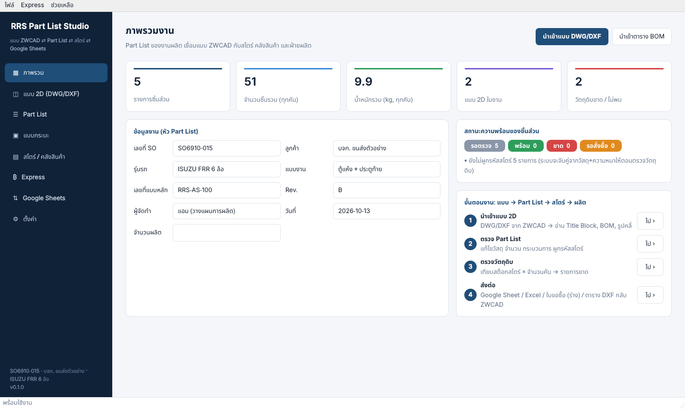 |
| แบบ 2D | ทะเบียนแบบ + ตัวอย่างแบบ (ส้ม = รูปคลี่, ฟ้า = รู) + สถานะแบบ | 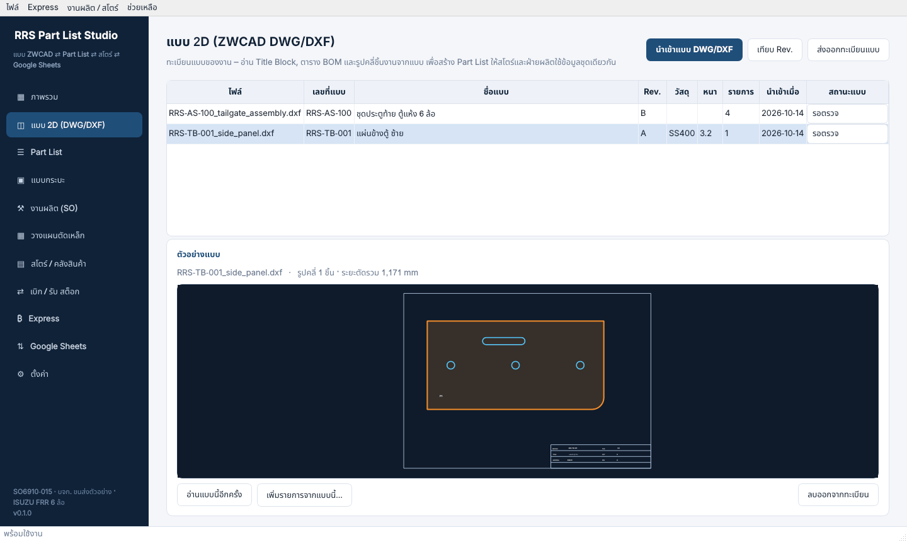 |
| Part List | ตารางแก้ไขได้, ค้นหา, กรองสถานะ, ปุ่ม *ปรับความหนา…* / *เปลี่ยนวัสดุ…*, แถวแดง/เหลืองเตือนข้อมูลไม่ครบ, นำเข้า/ส่งออก | 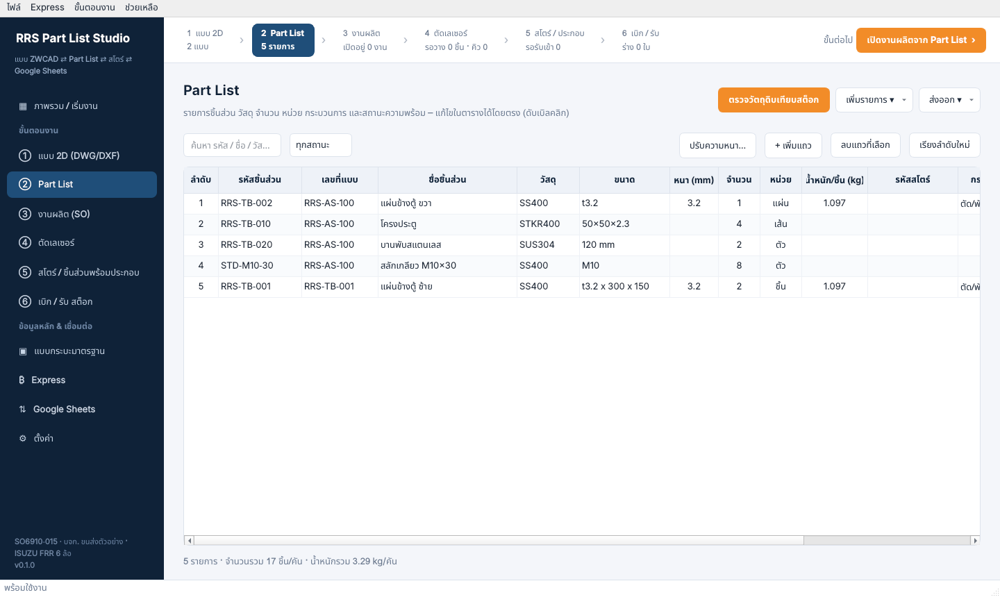 |
| สโตร์ / คลังสินค้า – ตรวจวัตถุดิบ | ต้องใช้ × จำนวนคัน เทียบคงเหลือ, แนะนำสั่งซื้อ, ส่งออกใบขอซื้อ (ร่าง), คอลัมน์ *การจับคู่* · แท็บ *จับคู่ชิ้นส่วน ↔ สต็อก* (รหัสในแบบ → รหัสสินค้า: รหัสตรง / รหัสชิ้นส่วนเดียวกัน (A = ทุกยี่ห้อ) / จากชื่อ / ใกล้เคียง (จับคู่ให้ พร้อมตัวเลือกอื่น) / ไม่พบ, ยืนยันเป็นรหัสสโตร์) · ตรวจให้เองเมื่อนำเข้าสต็อกหรือแบบ | 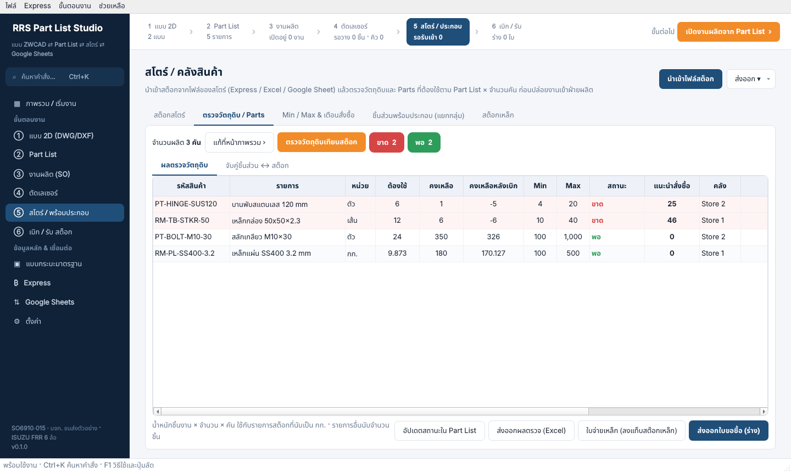 |
| สโตร์ / คลังสินค้า – สต็อก | ตารางสต็อกจากสโตร์ (แก้ไขได้) | 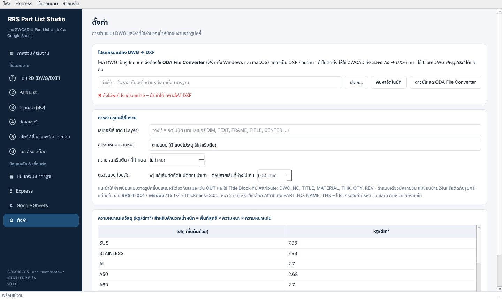 |
| Google Sheets | เชื่อมต่อ (Service Account / OAuth), ดึง/ส่ง Part List, สต็อก, ผลตรวจ | 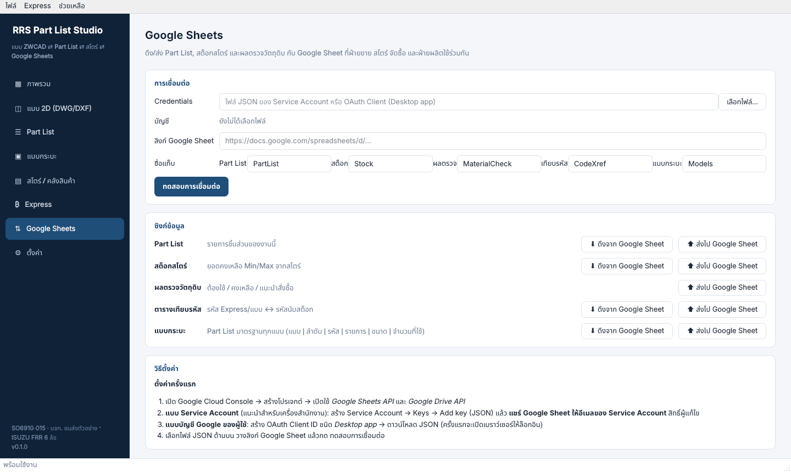 |
| ตั้งค่า | ตัวแปลง DWG, เลเยอร์เส้นตัด, ความหนาแน่นวัสดุ |  |
| แบบกระบะ | Part List มาตรฐานทุกแบบพร้อมรูป, ยอดคงเหลือของแต่ละชิ้น, สร้าง Part List จากแบบ | 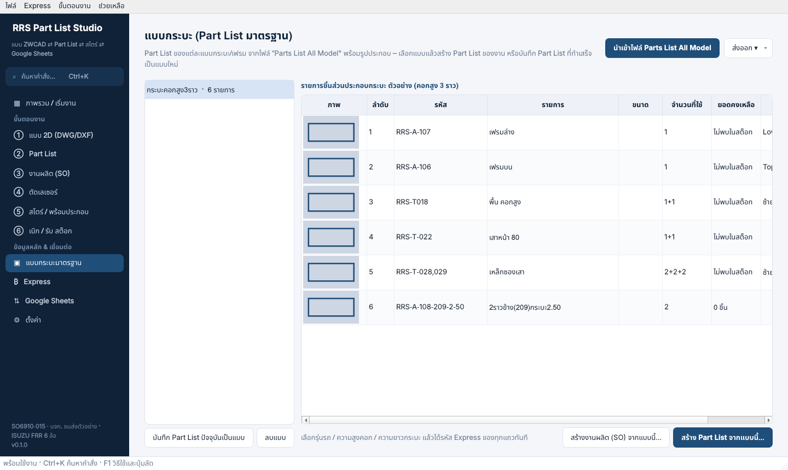 |
| Express | นำเข้า / ส่งออกร่าง PD-ใบขอซื้อ-สินค้าใหม่ / ตรวจรหัส / เทียบกับ Google Sheet | 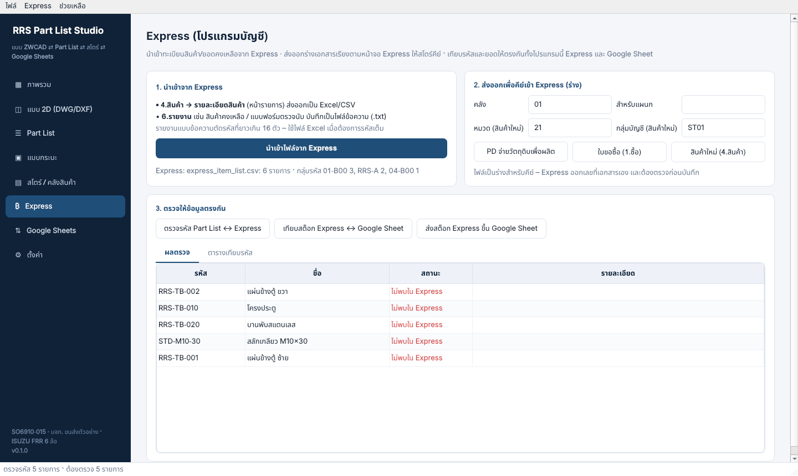 |
| Express – ตารางเทียบรหัส | รหัส Express/แบบ ↔ รหัสนับสต็อก (จับคู่จากชื่อ, ยืนยันเอง) | 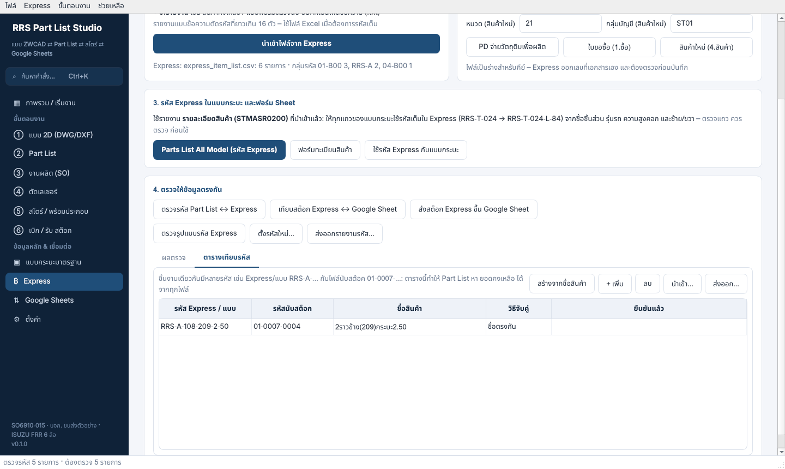 |
| หน้าต่างนำเข้าแบบ | เลือกไฟล์ทางซ้าย, ดูตัวอย่าง + Title Block, ติ๊กรายการที่จะเพิ่ม · รหัส/ชื่อ/ความหนา/จำนวน/วัสดุรายชิ้นจากป้ายที่รูปคลี่ (`16 ชิ้น M=Steel`), แถบความหนา (ตามแบบ / กำหนดเองทุกชิ้น, ใช้กับแถวที่เลือก, คืนค่าตามแบบ), คอลัมน์ *ความหนาจาก* (แดง = ไม่พบ, ส้ม = ค่าเริ่มต้น/กำหนดเอง) และ *จำนวนจาก* (ส้ม = แบบไม่ระบุ/กำหนดเอง), แถบ/คอลัมน์ *วัสดุ* + *วัสดุจาก* (เลือกจากรายการ, คืนค่าตามแบบ) | 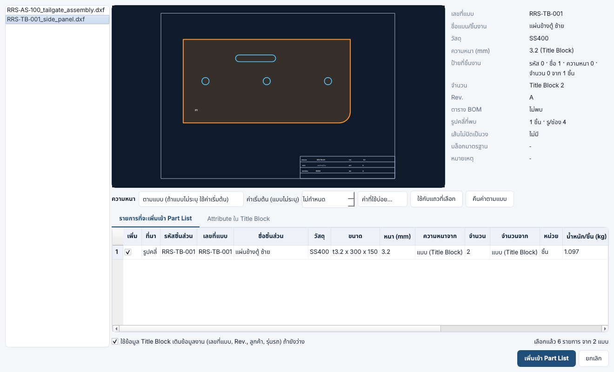 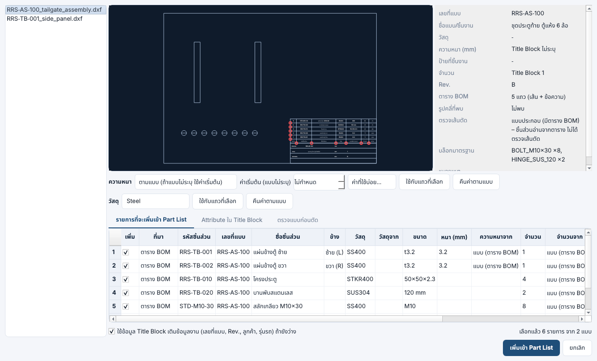 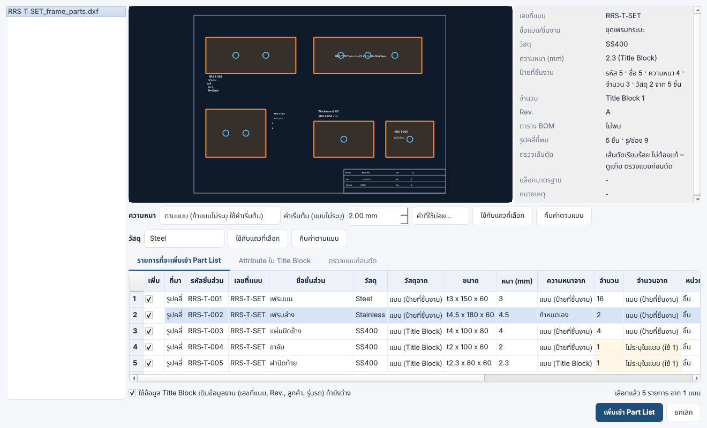 |
| หน้าต่างนำเข้าแบบ – ตรวจแบบก่อนตัด | ตารางจุดที่แก้อัตโนมัติ (เขียว) / ต้องแก้แบบ (แดง) / ข้อมูล (เส้นพับ, ข้อความในชิ้นงาน), คลิกแถวซูมไปที่จุดนั้น, แก้เส้นอัตโนมัติ + ระยะต่อปลายเส้น → ตรวจใหม่, บันทึกแบบที่แก้แล้ว (DXF) | 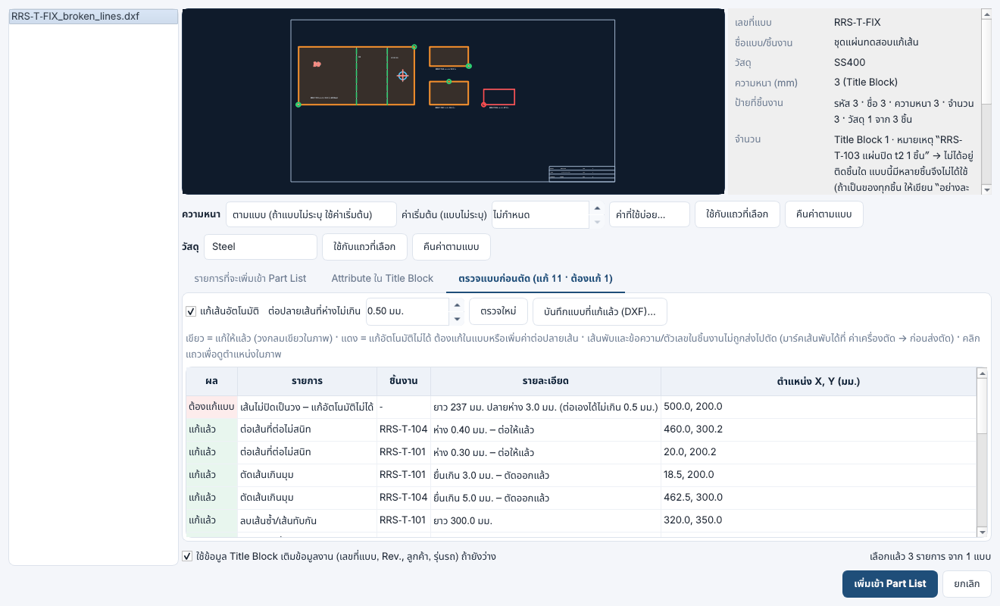 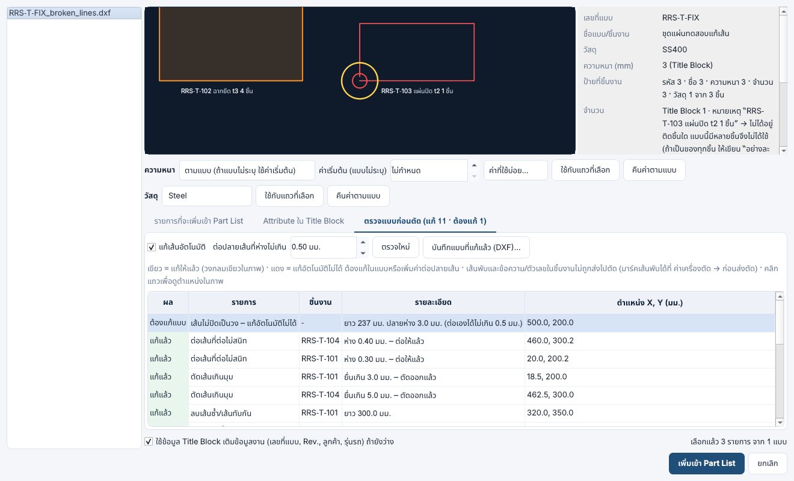 |
| หน้าต่างจับคู่คอลัมน์ | ยืนยันว่าคอลัมน์ในไฟล์ ZWCAD/Excel/Google ตรงกับช่องใด | 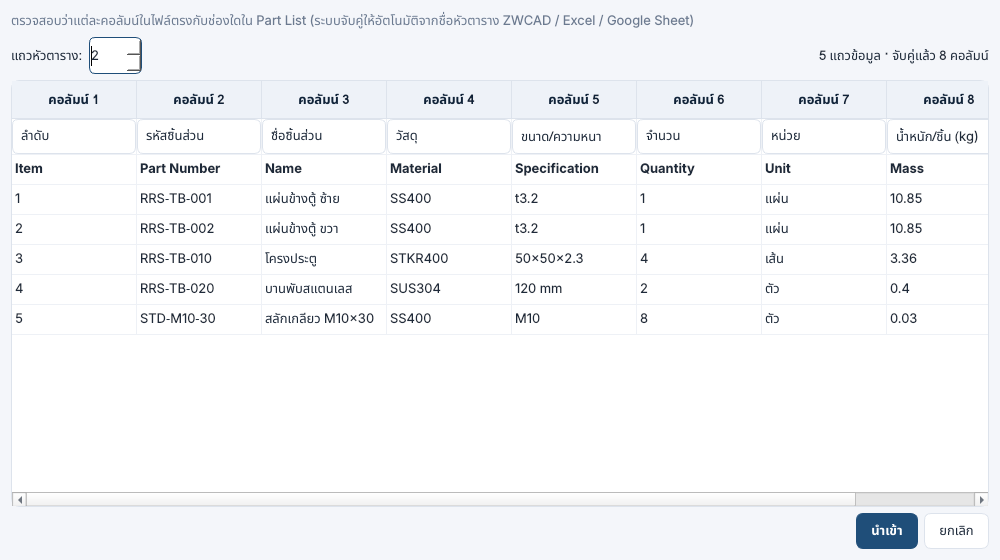 |
| เลือกรุ่นย่อย | รุ่นรถ / ความสูงคอก / ความยาว → รหัส Express ทุกแถว เลือกรหัสอื่นต่อแถวได้ | 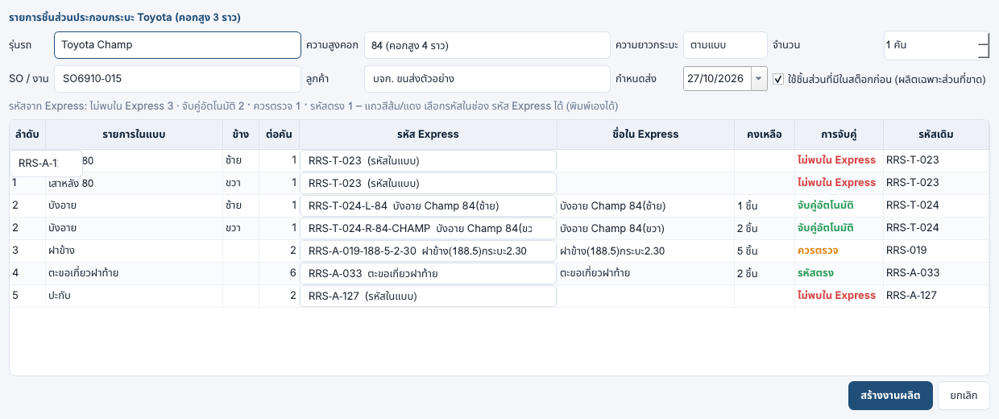 |
| งานผลิต (SO) | งาน × จำนวนคัน, จำนวนที่ผ่านแต่ละขั้น (แก้ในช่องสีเหลือง), สถานะ รอตัด/รอพับ/รอเชื่อม/เสร็จ, สร้างใบเบิก/รับ, ช่องสแกนใบงาน (QR) | 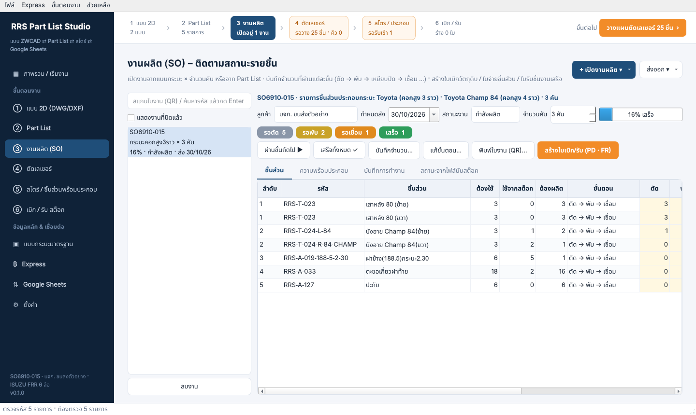 |
| งานผลิต – ความพร้อมประกอบ / ใบงาน QR | % พร้อมต่อกลุ่มประกอบ (แถบเขียว = ครบ ปล่อยประกอบได้, ส้ม = ยังขาด) · ขาดชิ้นไหน อยู่ขั้นไหน · ใบจัดชุด Excel · ใบงาน A6 พร้อม QR (รายละเอียด Part List + วัสดุ): รหัสตามแบบ DWG / รหัส Express, รูป 2D จากแบบพร้อมขนาด, ยี่ห้อ/รุ่นรถ, รุ่นกระบะ, ขนาด, ขั้นตอน และที่เก็บ – พิมพ์ A6 1 ใบ/แผ่น หรือ 2 / 4 / 8 ใบต่อ A4 พร้อมเส้นตัด | 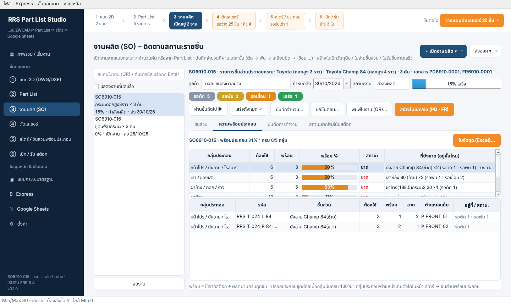 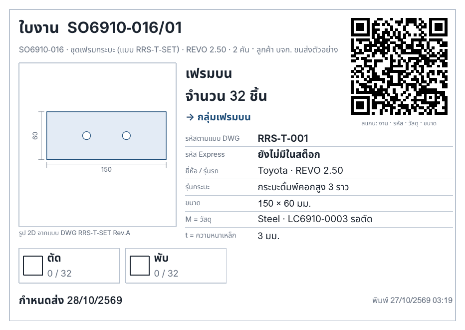 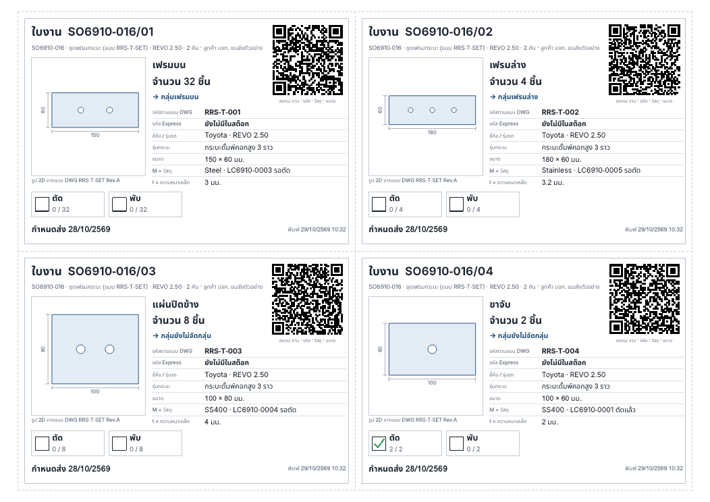 |
| เบิก / รับ สต็อก | เอกสาร PD OU FR RR AJ, บันทึกแล้วยอดเปลี่ยน, ประวัติการเคลื่อนไหว, วัตถุดิบต่อชิ้น | 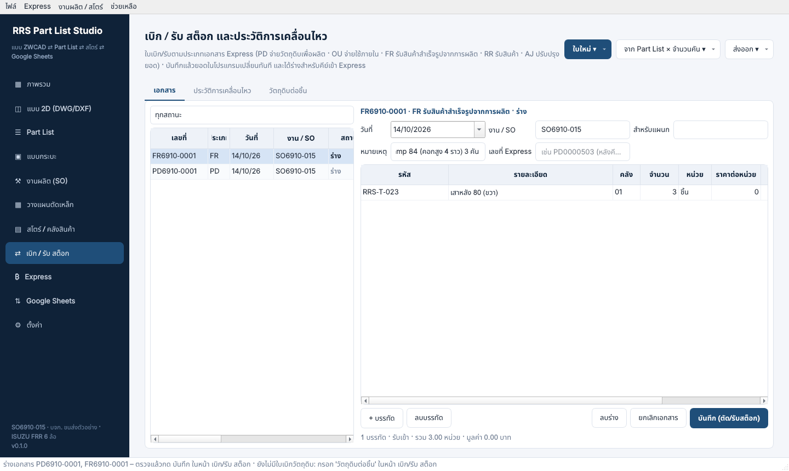 |
| ตัดเหล็ก / เลเซอร์ – วางแผนตัด | จาก Part List × คัน หรือจากงานผลิตที่เปิดอยู่ (ติ๊กงาน): แผ่นที่ใช้ต่อวัสดุ/ความหนา, % ใช้เหล็ก, ภาพการวางชิ้นงาน | 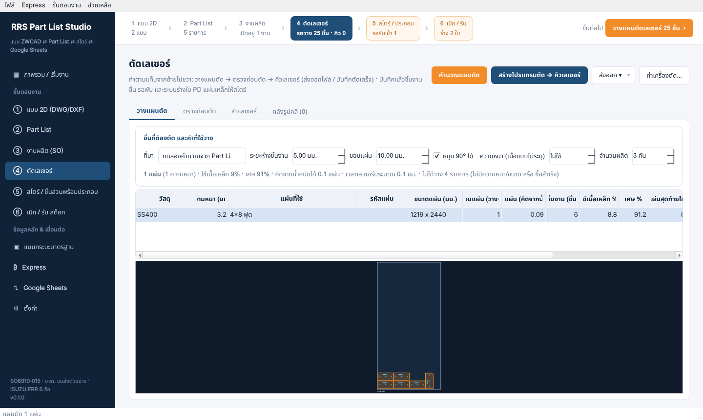 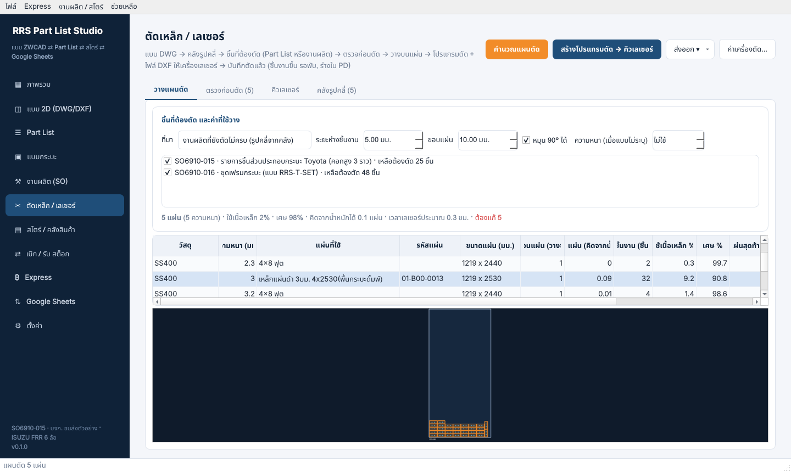 |
| ตัดเหล็ก / เลเซอร์ – ตรวจก่อนตัด | รูเล็ก, รูชิดขอบ, ชิ้นเล็ก, เส้นซ้อน, ไม่มีความหนา, ใหญ่กว่าแผ่น (แดง = ต้องแก้, ส้ม = เตือน) | 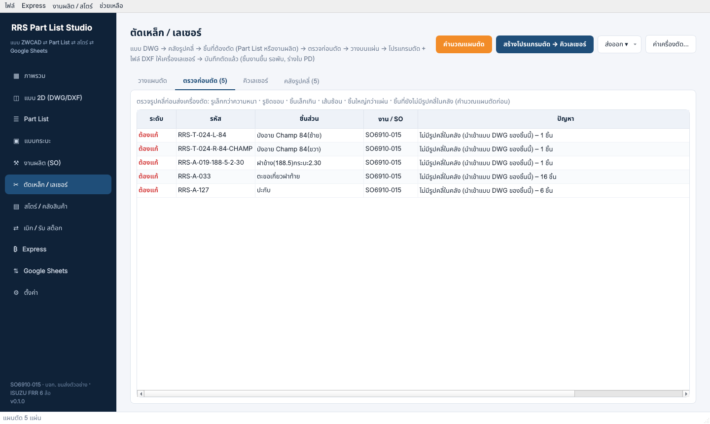 |
| ตัดเหล็ก / เลเซอร์ – คิวเลเซอร์ | โปรแกรม LC… รอตัด/กำลังตัด/ตัดแล้ว, เวลาตัด, ภาพแผ่น, บันทึกตัดเสร็จ (→ งานผลิตผ่านขั้นตัด + ร่าง PD) | 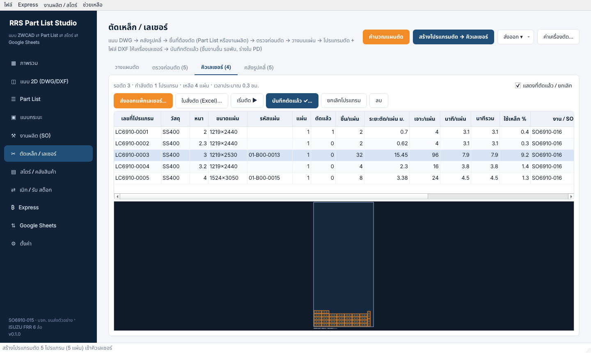 |
| ตัดเหล็ก / เลเซอร์ – คลังรูปคลี่ | รูปคลี่ของทุกรหัสจากแบบที่นำเข้า (ขนาด, รู, ระยะตัด, แบบ/Rev.) | 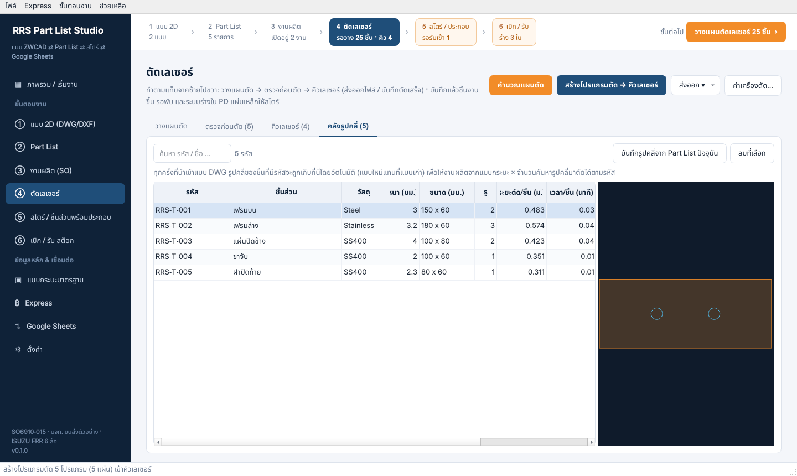 |
| ตัดเหล็ก / เลเซอร์ – เพิ่มชิ้นลงที่ว่าง | เลือกแผ่น (แผนตัด) หรือโปรแกรมที่รอตัด → เลือกชิ้นจากคลังรูปคลี่ (วัสดุ/ความหนาเดียวกัน) + จำนวน/เต็มที่ว่าง, ภาพที่ว่าง (กรอบเขียว) และชิ้นที่จะเพิ่ม | 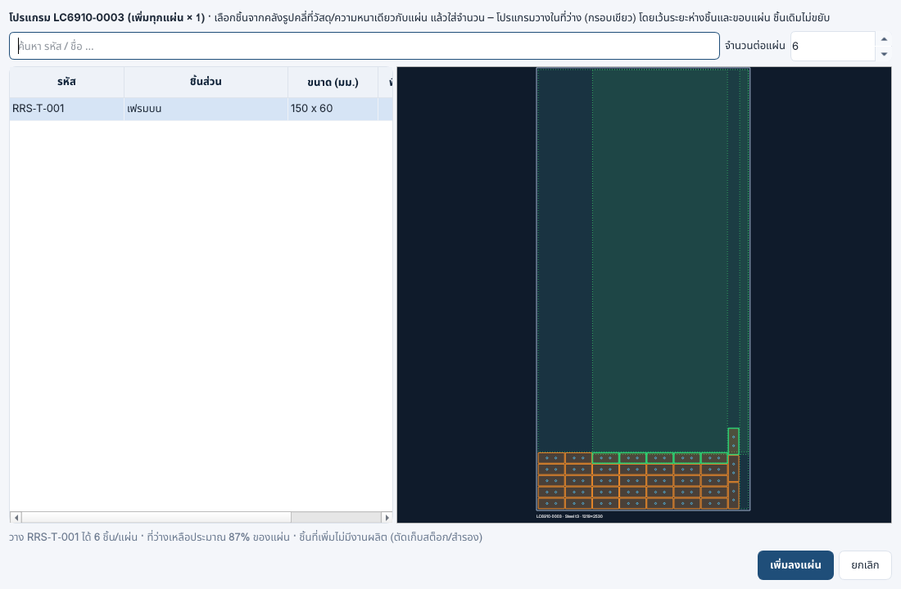 |
| ค่าเครื่องตัด – ก่อนส่งตัด | Mark (รหัส, เส้นพับ: ขีดที่ขอบ/เต็มเส้น) · Nest (ระยะห่างตามความหนา, หมุนชิ้นที่วาดเอียง) · Gap/micro-joint (ชิ้นเล็ก/ทุกชิ้น, ความกว้าง, จำนวนจุด) | 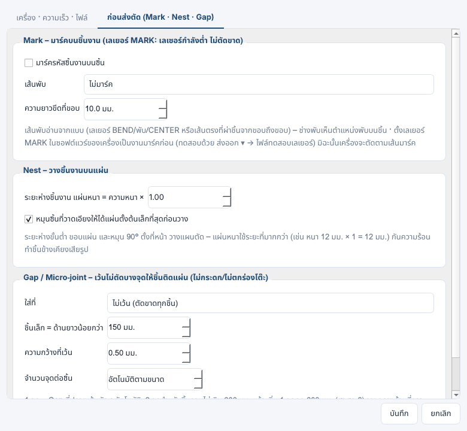 |
| สโตร์ – Min / Max | ใช้เฉลี่ย/วัน, Min/Max แนะนำ, สถานะสั่งซื้อ | 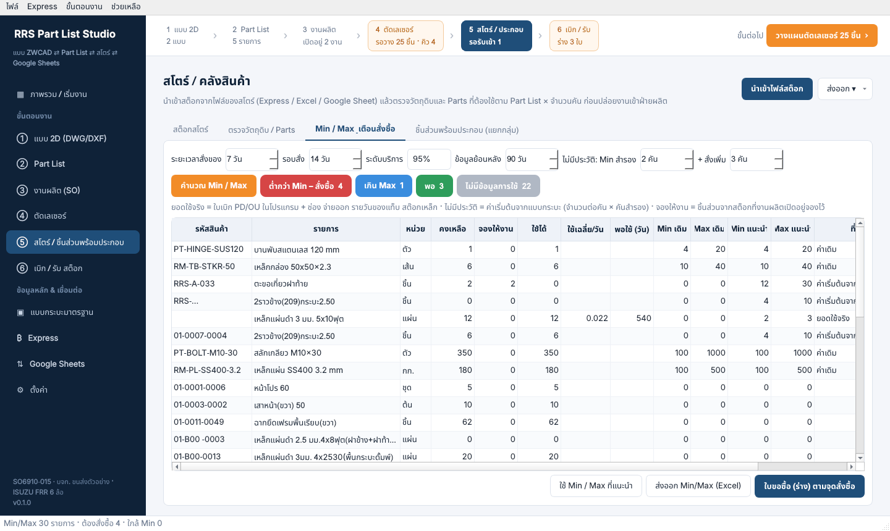 |
| สโตร์ – ชิ้นส่วนพร้อมประกอบ (แยกกลุ่ม) | 10 กลุ่มประกอบทางซ้าย · สต็อก 6 ช่องต่อรหัส · ค้นหา/สแกนป้าย · ตำแหน่งเก็บ (แก้ในตาราง) · ตั้งกลุ่มเอง · พิมพ์ป้าย QR ชั้นวาง | 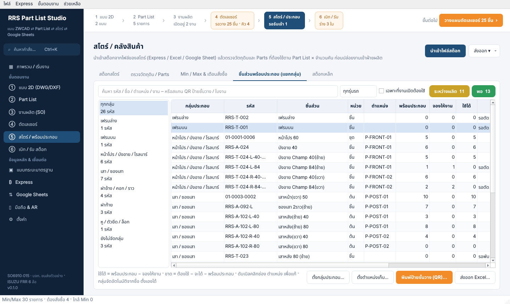 |
| Express – ตรวจรูปแบบรหัส / ตั้งรหัสใหม่ | รหัสที่ผิดกฎ + ข้อเสนอ, ตั้งรหัสใหม่ไม่ให้ซ้ำ | 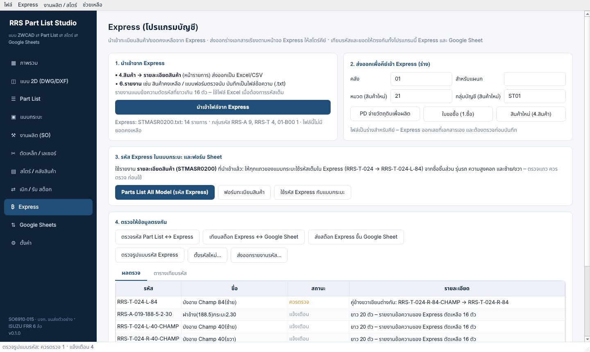 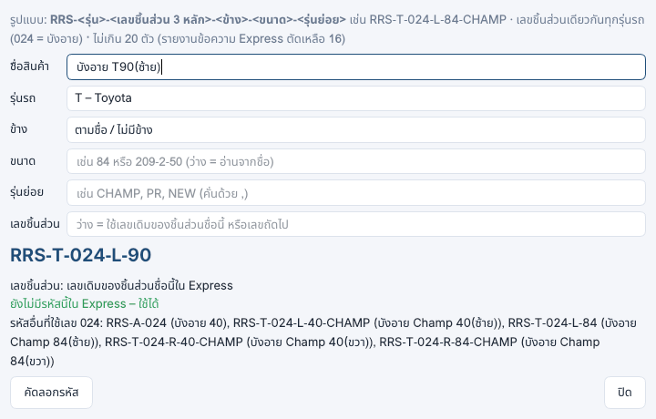 |
| เทียบ Rev. | เพิ่มใหม่ / ตัดออก / จำนวนเปลี่ยน / แก้ไข | 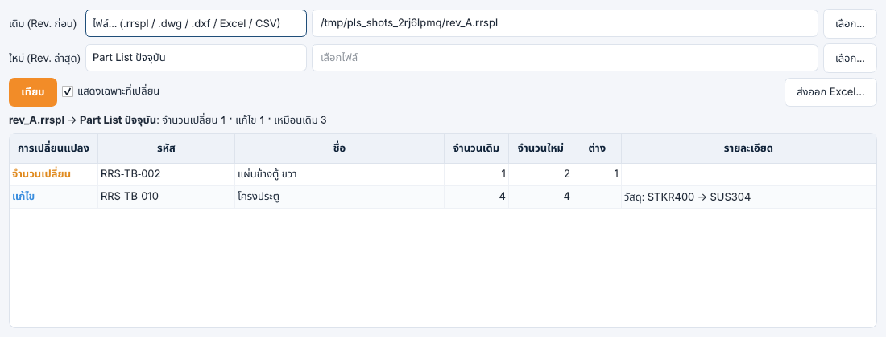 |

## สีและตัวอักษร

| Token | ค่า | ใช้กับ |
|---|---|---|
| Navy | `#1F4E79` | ปุ่มหลัก, หัวตาราง Excel ที่ส่งออก, เมนูที่เลือก |
| Navy deep | `#0F2238` | แถบเมนูซ้าย |
| Accent | `#F28C28` | ปุ่มตรวจวัตถุดิบ, เส้นรูปคลี่ในตัวอย่างแบบ |
| Background | `#F4F6FA` | พื้นหลังหน้า |
| Card | `#FFFFFF` + เส้นขอบ `#DDE3EC` มุมโค้ง 10px | การ์ด / ตาราง |

ปุ่ม: *primary* (น้ำเงินทึบ) = การกระทำหลักของหน้า 1 ปุ่ม, *accent* (ส้ม) = การตรวจ/คำนวณ, ปกติ (ขาว) = อื่นๆ

## การโต้ตอบที่สำคัญ

* ลากไฟล์ `.dwg/.dxf` มาวางบนหน้าต่าง = นำเข้าแบบ, ลากไฟล์ `.rrspl` = เปิดงาน
* ตัวอย่างแบบ: ล้อเมาส์ = ซูม, ลาก = เลื่อน, ดับเบิลคลิก = ดูทั้งแบบ
* งานที่ใช้เวลานาน (แปลง DWG, Google Sheets) ทำเบื้องหลัง – หน้าจอไม่ค้าง
* ชื่อหน้าต่างมี `*` เมื่อยังไม่ได้บันทึก และถามก่อนปิดโปรแกรม
